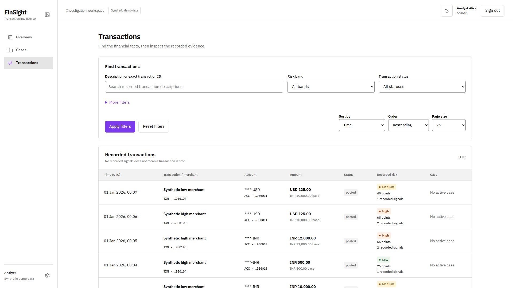
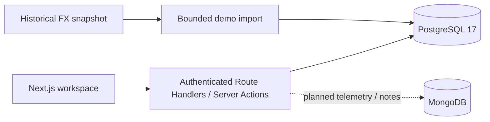

# FinSight

Financial transaction review and traceable investigation, built with Next.js and PostgreSQL.

[](https://github.com/KadakWNL/finsight/actions/workflows/checks.yml)

[Get started](#get-started) · [Demo data](#demo-data-and-currency-conversion) · [Database design](#architecture-and-database-design) · [Verification](#verification) · [Course requirements](#course-requirements) · [Documentation](#documentation)

FinSight helps an analyst find unusual transactions, inspect the recorded signals behind a risk score, and open an investigation. Admins oversee case activity. Database constraints and guarded SQL commands preserve financial facts, enforce case transitions and retain an immutable decision history.

<picture>
  <source media="(prefers-color-scheme: dark)" srcset="docs/screenshots/transactions-dark.png">
  
</picture>

The captures show the running application with generated synthetic data. The workspace supports light/dark themes, a square sidebar selection and expandable typed identifiers that retain access to full UUIDs.

## Implemented features

| Area | Available behavior |
|---|---|
| Authentication | Provisioned analyst/admin identities, Argon2id passwords, encrypted cookies, PostgreSQL-backed session expiry and sign-out |
| Discovery | Role overview, description/exact-ID search, date/status/risk/entity/amount filters, stable signed cursor paging |
| Transaction evidence | Masked customer/account context, original currency and INR base amounts, recorded contributions, rule context and completeness caveats |
| Investigation | Case creation, scoped queue/detail/history, and role-aware lifecycle dialogs backed by guarded APIs |
| Workspace preferences | [Settings and collapsible navigation](docs/discovery-ui.md#settings-and-display-preferences), browser appearance, time zone and original/INR amount display |
| Demo data | Reproducible linked activity, saved historical FX observations, conflict-safe import and offline replay |
| Integrity | PK/FK/check constraints, retained financial facts, unique active cases, version conflicts, idempotent commands and immutable events |

The [case screens](docs/case-ui.md) support investigation and lifecycle review. MongoDB telemetry and analyst notes, general administration and semantic search are not exposed as working features. A recorded risk score supports review; it is not a fraud verdict.

## Get started

Use **Node.js 24**, npm and **PostgreSQL 17**. Native local PostgreSQL works; Docker Desktop is optional.

### 1. Install and configure

```powershell
git clone https://github.com/KadakWNL/finsight.git
cd finsight
npm ci
Copy-Item .env.example .env.local
```

Copy the environment example once, then edit `.env.local` with your own values. Never overwrite an existing local configuration or commit credentials.

Create a local database such as `finsight_demo` with a dedicated non-superuser migration owner and a separate nonowner runtime role. Configure:

- `MIGRATOR_DATABASE_URL`: the migration/provisioning connection to that database.
- `DATABASE_URL`: the restricted runtime connection to the same database.
- `AUTH_SECRET`: a locally generated random secret of at least 32 characters.
- `NEXTAUTH_URL=http://localhost:3014`: the exact browser origin used below.
- `ALLOW_SYNTHETIC_SEED=true`: explicit permission for local synthetic data commands.

Synthetic tooling requires a local database name ending in `_demo` or `_test`. [Development setup](docs/development-setup.md) owns the environment inventory, isolated test database and role requirements.

### 2. Apply the schema and provision demo users

```powershell
npm run db:migrate
```

Migrations through 055 supply financial/operational tables, guarded writes and protected session validation. Existing standard role names receive runtime grants automatically. For custom role names, the migration owner must call both runtime and authentication grant procedures described in [authentication setup](docs/authentication.md#configure-and-provision).

Set `DEMO_ANALYST_PASSWORD` and `DEMO_ADMIN_PASSWORD` in ignored local configuration, then run:

```powershell
npm run auth:provision -- --demo
```

Use `analyst_a@finsight.local` or `admin@finsight.local` with the passwords you supplied. No default passwords or public registration are provided. The separate bootstrap-admin command supports initial administrator provisioning outside the demo flow.

### 3. Load data and start the application

```powershell
npm run demo:fx -- --out=data/local/fx-2026-q1.json
npm run demo:import -- --snapshot=data/local/fx-2026-q1.json --manifest=data/local/demo-2026-q1.manifest.json
npm run dev -- --port 3014
```

Open **[http://localhost:3014/sign-in](http://localhost:3014/sign-in)**. The sidebar Settings gear opens [appearance and display preferences](docs/discovery-ui.md#settings-and-display-preferences); the button beside FinSight collapses the desktop sidebar. If you choose another port, change `NEXTAUTH_URL` to match before starting the server.

The public landing page and process-health endpoint do not require a database. Authenticated screens require the configured PostgreSQL instance.

## Demo data and currency conversion

Two data paths serve different purposes:

- `npm run db:seed` verifies eight exact regression scenarios, including conversion boundaries and risk-score expectations.
- `demo:fx` plus `demo:import` builds a larger linked demonstration dataset from a fixed seed and saved historical observations. [Dataset documentation](docs/demo-dataset.md) owns defaults, bounds, provenance and rerun instructions.

The larger generator creates customers, addresses, INR/USD accounts, cards, devices, merchants and timestamped card activity. All records are synthetic. It assigns no ground-truth fraud labels and is not a calibrated fraud benchmark. Existing regression fixtures and retained financial facts are preserved.

FX snapshots come from [Frankfurter's ECB provider endpoint](https://frankfurter.dev/#rates-by-provider). Conversion uses the latest available observation strictly before the UTC transaction date, subject to a seven-day freshness bound. The selected rate is stored with the transaction; PostgreSQL calculates the rounded INR base amount using exact decimals. These are reference conversions, not executed bank/card settlement rates.

Keep the local snapshot and manifest to reproduce an import offline and inspect each USD transaction's reference-date assignment. Fetch failures never substitute invented rates. Conflicts or scoring failures roll back the import, and retries preserve recorded signals. Generated local artifacts are excluded from Git.

## Architecture and database design



PostgreSQL stores related financial facts, rules/signals, operator identities, sessions, cases, command receipts and history. Hand-written parameterized SQL and stored functions own integrity and state changes; the project uses no ORM.

MongoDB is the planned second database for heterogeneous device telemetry, scoped aggregation and later analyst notes. It is **not connected yet**. Collection validators, indexes, authorization and failure recovery must precede its feature panels. Vector retrieval is optional and deferred.

The [ER design and relational mapping](docs/er-diagram.md) links to the field dictionary and three report figures:

- [Identity and banking](docs/er-diagram-1-identity-banking.svg)
- [Transactions and risk](docs/er-diagram-2-transactions-risk.svg)
- [Investigation](docs/er-diagram-3-investigation.svg)

The canonical diagram source is [Mermaid](docs/er-diagram.mmd); derived figures are reproduced by [the rendering script](scripts/render_er.py). The historical PlantUML draft is excluded from implementation/report use.

## Verification

Configure a separate disposable local database ending in `_test`, with `TEST_DATABASE_URL` and `ALLOW_TEST_DATABASE=true`. Integration suites create and remove their fixtures there; do not point them at the running demo. Nonowner authentication probes also require the role setup documented in [authentication verification](docs/authentication.md#verification).

```powershell
npm run lint
npm run typecheck
npm run test:unit
npm run test:api
npm run test:db
npx playwright install chromium
npm run test:e2e
npm run build
```

Vitest covers validation, migration behavior and PostgreSQL-backed handlers. Playwright checks real sign-in, discovery, masks, role denial, case lifecycle, recovery, keyboard/mobile behavior, sidebar collapse and Settings preferences. Browser checks start their own server on port 3100; stop another development server for this checkout before running them.

[GitHub Actions](https://github.com/KadakWNL/finsight/actions) records the reproducible checks. The separate [MVP acceptance command](docs/mvp-acceptance.md) runs VS01-VS16 against a fresh database with a restricted application login and produces a result matrix, query plans and browser recordings. Technical success still requires teammate cross-review; component and MVP tests do not establish final academic acceptance.

## Course requirements

FinSight follows the locally supplied **DBMS Experiential Learning, Level 3 Project Requirements**. PostgreSQL is explicitly permitted alongside MySQL. The chosen track is SQL plus NoSQL; a second database and its advanced feature are required for completion. The local course PDF is not redistributed.

| Brief items | Repository evidence | Remaining completion work |
|---|---|---|
| 1, 17: meaningful problem beyond CRUD | Explainable risk review, guarded investigations, concurrency and immutable decisions | Confirm section title uniqueness; retain final demonstration and acceptance evidence |
| 2, 14, 15: two-member team, Git and contribution evidence | [Commit history](https://github.com/KadakWNL/finsight/commits/main/), [pull requests](https://github.com/KadakWNL/finsight/pulls), [project board](https://github.com/users/KadakWNL/projects/5) | Course team approval, individual database/application contribution evidence and timed demonstration |
| 3: multiple database paradigms | Implemented PostgreSQL model; documented MongoDB boundary | MongoDB integration and scoped aggregation |
| 4: database design | ER figures, relational mapping, dictionaries and constraints | Executable NoSQL collections, validators and indexes |
| 5: DDL | Ordered CREATE/ALTER migrations; disposable DROP checks | Final demonstration evidence |
| 6: meaningful DML and queries | Financial/case INSERT, guarded UPDATE, scoped SELECT, joins, grouping, ordering and aggregates | Audited nonfinancial DELETE and final query evidence; financial DELETE stays blocked |
| 7: four SQL advanced concepts plus a NoSQL/vector concept | Transactions, views, stored functions, triggers, indexes and full-text search | NoSQL aggregation demonstration |
| 8: optional vector search | Deferred retrieval design | Optional embedding/model/storage/metric evidence if implemented |
| 9-12: Next.js, backend integration, roles and integrity | Discovery and case UI, authenticated APIs, analyst/admin policy and database constraints | Complete academic acceptance run |
| 13: soft-copy documentation | Architecture, schema, API contracts, screenshots and reproducible checks | Final report, measured test results and conclusion |
| 16: originality | Project-specific schema, workflow guards and independently authored demo generator | Preserve source attribution and individual implementation evidence |

The [requirements traceability](docs/requirements-traceability.md) and [testing contract](docs/development-and-testing-contract.md) own the detailed acceptance plan. [Mongo telemetry](https://github.com/KadakWNL/finsight/issues/17), [session cleanup](https://github.com/KadakWNL/finsight/issues/23) and [academic verification](https://github.com/KadakWNL/finsight/issues/18) track material remaining work. This README does not claim the full course submission is complete.

## Documentation

| Read this | For |
|---|---|
| [Development setup](docs/development-setup.md) | Environment, roles, database isolation and command reference |
| [Discovery workspace](docs/discovery-ui.md) / [design system](DESIGN.md) | Routes, themed shell, interaction boundaries and visual tokens |
| [Case workspace](docs/case-ui.md) | Queue views, lifecycle dialogs, conflict recovery and audit history |
| [MVP acceptance](docs/mvp-acceptance.md) | Fresh database requirements, VS01-VS16 evidence, recordings and human review gates |
| [Authentication](docs/authentication.md) | Provisioning, cookies, sessions, grants and role checks |
| [Transaction API](docs/transaction-api.md) / [Case API](docs/case-api.md) | Request validation, scoping, pagination and guarded commands |
| [Demo dataset](docs/demo-dataset.md) / [deterministic risk](docs/deterministic-risk.md) | Generated activity, historical conversion and exact regression fixtures |
| [ER mapping](docs/er-diagram.md) / [financial baseline](docs/financial-baseline.md) / [operational schema](docs/operational-schema.md) | Relational model, dictionaries and implemented storage boundaries |
| [Financial guards](docs/financial-guards.md) | Retention, constraints, locking and integrity checks |
| [Product workflows](docs/product-workflows.md) / [information architecture](docs/information-architecture.md) | Permissions, journeys and screen inventory |
| [Risk contract](docs/risk-formula-contract.md) / [case-auth contracts](docs/case-auth-contracts.md) | Approved formulas and state/session invariants |
| [Architecture assessment](docs/architecture-gaps.md) / [requirements](docs/requirements-traceability.md) | Design decisions, capability gates and academic mapping |
| [Session cleanup contract](docs/session-cleanup-contract.md) | Scoped nonfinancial deletion and audit requirements |

Design documents retain proposed or historical sections. Executable migrations, source, API references and current check results establish implemented behavior.
