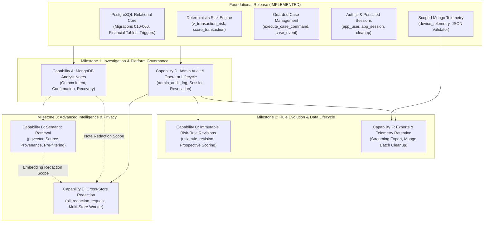

# FinSight — Deferred Capability Register and Follow-up Handoffs

**Document Version:** 1.0.0  
**Status:** Reviewed Architectural Handoff Specification  
**Issue Reference:** [Issue #20: Prepare gated follow-up handoffs after academic completion](https://github.com/KadakWNL/finsight/issues/20)  
**Accountable Owner:** `@ShrikarDesai07`  
**Cross-Reviewer:** `@KadakWNL`  
**Planning Phase / Priority:** Advanced Features / P3  
**Handoff Scope Estimate:** 1 relative point (applies exclusively to this handoff document; future implementation effort remains explicitly unestimated)  
**Target Branch:** `main`  
**Prerequisites:** Issue #16 (MVP acceptance VS01–VS16, closed) and Issue #19 (Academic submission package, closed)

---

## 1. Executive Summary and Architectural Purpose

FinSight's core architecture was intentionally partitioned into an **academic and MVP delivery core** and a **deferred capabilities portfolio**. The foundational release—delivered across seven PostgreSQL migrations (`010` through `060`), MongoDB `device_telemetry`, Next.js 16 App Router workspaces, and full acceptance suites (VS01–VS16)—establishes ACID financial accounting, deterministic explainable risk scoring, guarded single-active case state machines, immutable event sourcing, least-privilege role boundaries, and audited expired session deletion.

During architectural design ([`docs/architecture-gaps.md`](architecture-gaps.md)), six advanced capabilities were evaluated and deliberately deferred to protect foundational integrity, prevent premature dependency lock-in, and honor the academic submission timeline:

1. **MongoDB Analyst Notes and Asynchronous Recovery**
2. **Semantic Retrieval, Model Selection, and Source Provenance**
3. **Risk-Rule Revisions and Editing**
4. **General Administrator Audit and Operator Mutations**
5. **Cross-Store Redaction**
6. **Data Exports and MongoDB Telemetry Cleanup**

This document establishes the **Deferred Capability Register**. It defines the precise boundary between what is currently implemented in the codebase and what remains proposed, missing, or unresolved. It specifies the implementation gates, safety invariants, schema prerequisites, and definitions of ready required before any deferred feature may be scheduled for future implementation.

### Architectural Rules and Boundary Invariants

The following non-negotiable architectural rules govern all future work:

1. **Foundation Independence:** No embedding model selection, vector database extension, or AI framework shall act as a prerequisite for or block the existing operational foundation.
2. **Explicit Status Labels:** System properties and capabilities must be categorized using standardized labels:
   - `[Implemented]` — Verified in the current repository code, migrations, or tests.
   - `[Proposed]` — Recommended design or schema; neither approved nor applied.
   - `[Missing]` — Required technical prerequisite not yet created.
   - `[Unresolved]` — Policy or contract requiring explicit team consensus.
   - `[Gated]` — Feature whose runtime activation is strictly blocked until prerequisites and peer review are satisfied.
3. **Immutability of Historical Evidence:** No operational mutation (such as editing a risk rule or redacting user data) may rewrite or corrupt historical risk explanations, past transaction scores, or immutable case audit events.
4. **Strict Separation of Audit Concerns:** Case event history (`case_event`) and session cleanup audits (`app_session_cleanup`) are domain-specific ledgers. Neither shall be overloaded or treated as a substitute for a general administrator audit system.
5. **Separation of Planning from Approval:** The publication of this specification does not constitute contract sign-off, schema application, or authorization to start coding. Future implementation effort remains unestimated, unscheduled, and unassigned until each capability is split into an independent issue and formally reviewed by `@KadakWNL`.

---

## 2. Dependency Overview and Implementation Order

The six deferred capabilities have distinct technical dependencies. They must not be implemented arbitrarily or in parallel without respecting data model prerequisites. The diagram below illustrates the required sequence of implementation milestones:



### Milestone Sequencing Rationale

1. **Foundational Baseline:** The application core is already fully implemented, tested, and verified on `main`.
2. **Milestone 1 (Notes & Operator Audit):**
   - **Capability A (Notes)** expands investigation depth without altering relational financial tables. It requires MongoDB schema validation, SQL durable intent, and two-phase confirmation.
   - **Capability D (Operator Lifecycle & Admin Audit)** establishes `admin_audit_log`. This general audit infrastructure is a strict prerequisite for all subsequent administrative mutations (rule edits, redaction, and exports).
3. **Milestone 2 (Rule Revisions & Lifecycle Services):**
   - **Capability C (Rule Revisions)** builds upon the general audit framework from Capability D to permit fraud administrators to draft prospective rule versions without modifying historical explanations.
   - **Capability F (Exports & Cleanup)** leverages the audit ledger from Capability D to log bulk export downloads and introduces administrative batch cleanup for aged MongoDB telemetry.
4. **Milestone 3 (Semantic Search & Cross-Store Redaction):**
   - **Capability B (Semantic Retrieval)** requires confirmed notes from Capability A and an independent model benchmarking study before activating vector tables.
   - **Capability E (Redaction)** is the most complex governance feature. It spans PostgreSQL, MongoDB telemetry, MongoDB notes, and vector embeddings. It requires Capabilities A, B, and D to be either fully implemented or explicitly scoped out.

---

## 3. Deferred Capability Register

---

### A. MongoDB Analyst Notes and Asynchronous Recovery

#### 1. Purpose
Enable fraud investigators to attach free-form narratives, investigative hypotheses, and structured entity references (e.g., flagging suspicious IP clusters or merchant relationships) to active cases. Storing notes in MongoDB accommodates evolving narrative shapes while keeping PostgreSQL dedicated to structured financial accounting. A two-phase intent and confirmation protocol guarantees that unconfirmed drafts never leak into official case evidence.

#### 2. Current Repository State
- **Implemented:**
  - MongoDB 7 infrastructure in [`src/lib/mongo.ts`](file:///c:/Users/shrik/Finsight/finsight/src/lib/mongo.ts) managing connection pooling and timeouts.
  - Telemetry document model in [`scripts/telemetry-schema.mjs`](file:///c:/Users/shrik/Finsight/finsight/scripts/telemetry-schema.mjs) (`device_telemetry` collection only).
  - PostgreSQL investigation case state machine and atomic version increments in [`migrations/050_case_guards.sql`](file:///c:/Users/shrik/Finsight/finsight/migrations/050_case_guards.sql) and [`src/server/case-commands.ts`](file:///c:/Users/shrik/Finsight/finsight/src/server/case-commands.ts).
  - Immutable event sourcing in `public.case_event` protected by trigger `trg_reject_case_event_mutation`.
  - Partial unique index `idx_case_single_active` on `investigation_case(transaction_id)` restricting active cases.
- **Missing / Unimplemented:**
  - The `analyst_notes` collection does **not** exist in MongoDB.
  - No MongoDB `$jsonSchema` validator or indexes exist for analyst notes.
  - No SQL durable intent or outbox table exists in PostgreSQL.
  - `execute_case_command` does not support a `note_added` command type.
  - No API routes (`/api/v1/cases/[id]/notes`) or UI components exist.

#### 3. Proposed Scope
- Create MongoDB collection `analyst_notes`:
  - `_id`: ObjectId.
  - `note_id`: UUID string (canonical reference).
  - `case_id`: UUID string (foreign reference to `public.investigation_case.case_id`).
  - `author_user_id`: UUID string (foreign reference to `public.app_user.user_id`).
  - `body`: Sanitized text string (length: 1–10,000 characters; executable HTML strictly rejected).
  - `structured_observations`: Array of objects containing `entity_type` (`transaction`, `merchant`, `device`) and `entity_id` (UUID).
  - `idempotency_key`: Client-supplied UUID string.
  - `content_hash`: Hexadecimal SHA-256 hash of normalized body and observations.
  - `created_at`: ISODate timestamp.
- Strict MongoDB indexes:
  - Unique compound index: `{ case_id: 1, author_user_id: 1, idempotency_key: 1 }` (enforces client idempotency).
  - Secondary query index: `{ case_id: 1, created_at: -1, _id: 1 }` (enforces stable chronological pagination).
- PostgreSQL Durable Intent Outbox:
  - Table `case_note_intent`: records `(intent_id, case_id, author_user_id, idempotency_key, content_hash, status, created_at)` under an exclusive row lock on `investigation_case`.
- Two-Phase Write & Confirmation Protocol:
  1. *Intent Phase (SQL):* Verify caller is assigned analyst or admin; verify case is active (`open`, `in_review`, `escalated`); insert `case_note_intent` with status `'pending'`.
  2. *Document Write Phase (Mongo):* Idempotently insert document into `analyst_notes`.
  3. *Finalization Phase (SQL):* Call `execute_case_command('note_added', ...)` which re-checks case assignment and state under row lock, increments case `version`, marks intent `'confirmed'`, and emits a `note_added` event into `public.case_event` containing `note_id` and `content_hash` in `metadata`.
- Partial Failure & Quarantine Handling:
  - If Mongo succeeds but SQL finalization fails, note remains `'pending'` in SQL and is labelled *"Note awaiting confirmation"* in UI.
  - Background reconciliation worker retries finalization using `idempotency_key`.
  - If the case was closed or reassigned during the Mongo write, the note is moved to `'quarantined'` status and hidden from timeline and search.

#### 4. Out of Scope
- Note editing, revision in place, or deletion (notes are strictly append-only).
- Binary file attachments, PDFs, screenshots, or external S3/blob storage integration.
- Direct dual-writes from client without a durable PostgreSQL intent record.
- Exposing unconfirmed notes in case exports, timeline views, or search indexes.

#### 5. Implementation Gates
- **Gated:** Review and approval of `case_note_intent` DDL and state transition matrix by `@KadakWNL`.
- **Gated:** Security review verifying server-side HTML/script sanitization and entity ID validation.
- **Gated:** Automated failure-injection tests demonstrating quarantine behavior when SQL finalization is interrupted.

#### 6. Missing Prerequisites
- **Schema:** PostgreSQL migration adding `case_note_intent` table; script `scripts/mongo-notes-setup.mjs` creating `analyst_notes` with schema validator.
- **API:** `POST /api/v1/cases/[id]/notes` (staged write) and `GET /api/v1/cases/[id]/notes` (reads confirmed notes only).
- **Authorization:** Integration with `src/server/authorization.ts` enforcing assigned-analyst or supervisory admin rights.
- **Testing:** Integration tests for concurrent reassignment, idempotency replay, and MongoDB network outage simulation.

#### 7. Dependencies
- Dependent on existing Case Lifecycle ([`migrations/050_case_guards.sql`](file:///c:/Users/shrik/Finsight/finsight/migrations/050_case_guards.sql)) and MongoDB Connection ([`src/lib/mongo.ts`](file:///c:/Users/shrik/Finsight/finsight/src/lib/mongo.ts)).

#### 8. Risk and Recovery
- *Risk:* Split-brain inconsistency where MongoDB holds narrative text that PostgreSQL never acknowledged, potentially leaking unverified allegations.
- *Recovery:* Relational query filters join against `case_event` metadata. Any note in MongoDB lacking a confirmed `case_event` counterpart is ignored by the API and quarantined by the background reconciler.

#### 9. Definition of Ready
- [ ] Schema validator JSON specification committed and reviewed.
- [ ] Two-phase sequence diagram detailing SQL row-locking and failure branches approved.
- [ ] API contract for `POST /api/v1/cases/[id]/notes` published.
- [ ] Unestimated issue created and reviewed.

#### 10. Suggested Future Issue
- **Title:** `[Investigation/MongoDB] Implement durable analyst notes with two-phase SQL confirmation and reconciliation recovery`
- **Scope:** Create `analyst_notes` MongoDB validator, `case_note_intent` SQL migration, two-phase API route, and reconciliation worker.

---

### B. Semantic Retrieval, Model Selection, and Source Provenance

#### 1. Purpose
Allow fraud investigators to search historical investigation cases, notes, and fraud typologies using free-form natural language queries (e.g. *"card testing velocity bursts in electronics merchants"*). Semantic retrieval identifies conceptually related investigations that keyword search misses.

#### 2. Current Repository State
- **Implemented:**
  - Full-text search on `transaction.description` using PostgreSQL GIN index on `to_tsvector('english', description)` in [`migrations/030_financial_guards.sql`](file:///c:/Users/shrik/Finsight/finsight/migrations/030_financial_guards.sql), verified in `docs/academic/2026-10-30-query-plans.json`.
  - Synthetic fraud scenarios cataloged in `public.fraud_scenario` and `public.transaction_label` in [`migrations/020_operational_schema.sql`](file:///c:/Users/shrik/Finsight/finsight/migrations/020_operational_schema.sql).
- **Missing / Unimplemented:**
  - `pgvector` extension is **not** enabled.
  - No `semantic_document` table or vector columns exist in any migration.
  - No embedding model has been selected, benchmarked, or bundled.
  - No vector similarity search APIs or UI components exist.

#### 3. Proposed Scope
- **Post-Foundational Model Selection:**
  - Benchmark candidate open-weights models (e.g., `all-MiniLM-L6-v2` at 384 dimensions vs multilingual models at 768 dimensions) measuring inference latency, RAM footprint, and retrieval accuracy (MRR, Precision@K).
  - Selected embedding dimension $N$ is locked only when retrieval milestone begins.
- **Relational Vector Storage (`semantic_document`):**
  - Enable `pgvector` inside PostgreSQL.
  - Table `public.semantic_document`:
    - `document_id`: UUID primary key.
    - `doc_type`: Enum string (`'case_summary'`, `'transaction_summary'`, `'note_embedding'`).
    - `source_table`: String (`'investigation_case'`, `'transaction'`, or `'analyst_notes'`).
    - `source_id`: UUID string.
    - `case_id`: UUID string (mandatory relational foreign key for access scoping).
    - `content_hash`: Hexadecimal SHA-256 hash of original text.
    - `model_id`: String identifier (e.g. `'sentence-transformers/all-MiniLM-L6-v2'`).
    - `model_version`: Integer.
    - `embedding`: `vector(N)` (using selected dimension $N$).
    - `created_at`: TIMESTAMPTZ.
  - Source-aware composite unique constraint: `(source_table, source_id, doc_type, model_version)` preventing collisions between identical text across different cases.
  - Vector index: HNSW index (`USING hnsw (embedding vector_cosine_ops)`).
- **Relational Pre-Filtering Security Invariant:**
  - Vector similarity queries (`<=>` cosine distance) MUST execute with a relational pre-filter:
    ```sql
    SELECT s.document_id, s.case_id, s.doc_type, 1 - (s.embedding <=> $query_vec) AS similarity
    FROM public.semantic_document s
    JOIN public.investigation_case c ON c.case_id = s.case_id
    WHERE (c.assigned_to_user_id = $auth_user_id OR $is_admin = true)
      AND (s.embedding <=> $query_vec) < $distance_threshold
    ORDER BY s.embedding <=> $query_vec ASC
    LIMIT $limit;
    ```
  - Unassigned or unauthorized cases are filtered out *before* calculating similarity or returning snippets. Raw global nearest-neighbor searches are strictly forbidden.

#### 4. Out of Scope
- Selecting or downloading embedding models during foundational MVP setup.
- Integrating external cloud vector SaaS providers (Pinecone, Qdrant, Milvus); all vectors must reside in PostgreSQL to maintain transactional joins and least-privilege role boundaries.
- Generating embeddings from unconfirmed MongoDB notes or pending redaction targets.
- Automated clustering or autonomous decision-making based on similarity scores.

#### 5. Implementation Gates
- **Strict Architectural Invariant:** No embedding model selection or vector migration shall block the existing foundation.
- **Gated:** Formal benchmark evaluation report comparing at least two embedding models on representative financial investigation text.
- **Gated:** Completion of Capability A (Analyst Notes) if note embeddings are included in search corpus.
- **Gated:** Security review verifying that relational pre-filters prevent cross-tenant data leakage.

#### 6. Missing Prerequisites
- **Schema:** Migration enabling `CREATE EXTENSION IF NOT EXISTS vector;` and creating `public.semantic_document` with HNSW index.
- **API:** `POST /api/v1/search/semantic` accepting query string, minimum similarity score, and pagination tokens.
- **Background Worker:** Asynchronous embedding generation pipeline monitoring `case_event` and `analyst_notes`.
- **Testing:** Dimension compatibility test; authorization pre-filter isolation test (verifying Analyst A cannot retrieve Analyst B's case embeddings); retrieval benchmark suite.

#### 7. Dependencies
- Dependent on model evaluation decision.
- Dependent on Capability A for note embeddings.

#### 8. Risk and Recovery
- *Risk:* Vector drift after model upgrade; CPU/memory exhaustion during embedding generation; data leakage if pre-filtering is omitted.
- *Recovery:* Model version column allows atomic background re-indexing without taking search offline. Hard limits on query text length and result limits prevent resource exhaustion.

#### 9. Definition of Ready
- [ ] Embedding model evaluation report published with memory and latency benchmarks.
- [ ] `semantic_document` DDL and HNSW index parameters verified on PostgreSQL 17 test instance.
- [ ] Relational pre-filter query plan verified using `EXPLAIN (ANALYZE, BUFFERS)`.
- [ ] Unestimated issue created and reviewed.

#### 10. Suggested Future Issue
- **Title:** `[Retrieval/pgvector] Implement model-benchmarked semantic retrieval with source provenance and relational pre-filtering`
- **Scope:** Benchmark model, add `pgvector` migration, build asynchronous embedding pipeline and authorized search endpoint.

---

### C. Risk-Rule Revisions and Editing

#### 1. Purpose
Allow fraud policy administrators to modify risk rules (e.g. adjust threshold values, revise signal weights, or introduce new rule criteria) in response to emerging fraud typologies, while preserving 100% reproducibility and auditability of historical transactions.

#### 2. Current Repository State
- **Implemented:**
  - Relational tables `risk_rule` and `risk_signal` in [`migrations/040_deterministic_risk.sql`](file:///c:/Users/shrik/Finsight/finsight/migrations/040_deterministic_risk.sql).
  - Stored function `score_transaction(subject uuid)` enforcing exactly the 2 approved deterministic rules: `AMOUNT_BASE_GTE` (weight 40, threshold 10,000.00 INR) and `MERCHANT_TIER_GTE` (weight 25, threshold tier 2).
  - Database trigger `risk_rule_frozen` on `public.risk_rule` preventing any `UPDATE`, `DELETE`, or `TRUNCATE`.
  - Transaction detail workspace ([`src/components/workspace/transaction-detail.tsx`](file:///c:/Users/shrik/Finsight/finsight/src/components/workspace/transaction-detail.tsx)) displaying transparent signal breakdown and observed values against thresholds.
- **Missing / Unimplemented:**
  - No revision history table exists (`risk_rule_revision` does not exist).
  - `score_transaction()` rejects any rule count other than exactly 2.
  - `risk_signal` lacks an explicit foreign key to a rule revision ID.
  - No administrative rule editing UI or API exists.

#### 3. Proposed Scope
- **Immutable Rule Revision Data Model:**
  - Table `public.risk_rule`: retains stable metadata (`rule_id`, `rule_code`, `dimension`, `created_at`, `status`).
  - New table `public.risk_rule_revision`:
    - `revision_id`: UUID primary key.
    - `rule_id`: UUID foreign key to `public.risk_rule`.
    - `version`: Integer (sequential version number: 1, 2, 3...).
    - `weight`: Numeric(5,2) (points: 0 to 100).
    - `threshold_value`: Numeric(20,4) (numerical boundary).
    - `threshold_unit`: String (`'INR'`, `'tier_code'`).
    - `effective_from`: TIMESTAMPTZ (activation timestamp).
    - `effective_to`: TIMESTAMPTZ (nullable; NULL indicates currently active revision).
    - `created_by_user_id`: UUID foreign key to `public.app_user`.
    - `audit_rationale`: Text (mandatory explanation of threshold adjustment).
    - `created_at`: TIMESTAMPTZ.
  - Partial unique index: `idx_rule_active_revision` on `(rule_id) WHERE effective_to IS NULL` ensuring at most one active revision per rule.
- **Historical Immutability & Provenance Invariant:**
  - **Core Rule:** Modifying a rule must NEVER rewrite or recalculate the historical explanation, score, or observed values of previously scored transactions.
  - Update `public.risk_signal` to include `revision_id` foreign key.
  - Signal records retain an immutable complete firing snapshot: `observed_value`, `score_contribution`, `threshold_value`, and generated `evidence` string.
- **Prospective Evaluation Semantics:**
  - `score_transaction()` queries the active revision effective at the time of transaction scoring:
    ```sql
    SELECT * FROM public.risk_rule_revision
    WHERE rule_id = r.rule_id AND effective_to IS NULL;
    ```
  - Past transactions retain their existing `risk_signal` rows permanently.
- **Administrative Mutation Guard:**
  - Creating a revision requires `admin` role and inserts a corresponding audit record into `admin_audit_log` (Capability D).
  - Optimistic locking: revision creation requires providing `expected_version`.

#### 4. Out of Scope
- In-place SQL `UPDATE` or `DELETE` on existing `risk_rule` or `risk_rule_revision` rows.
- Dynamic user-defined rule code execution (e.g. running arbitrary SQL or script expressions).
- Retroactive re-scoring of past financial transactions (historical signals are permanent financial accounting facts).
- Client-side or unauthenticated rule modifications.

#### 5. Implementation Gates
- **Strict Architectural Invariant:** Modifying a rule must never rewrite the historical explanation of an earlier risk signal.
- **Gated:** Approval of the immutable revision schema and prospective scoring function by `@KadakWNL`.
- **Gated:** Integration with General Administrator Audit (Capability D).
- **Gated:** Regression test proving historical transactions 100–107 retain identical scores and explanation strings after a new revision is activated.

#### 6. Missing Prerequisites
- **Schema:** Migration creating `risk_rule_revision` table, adding `revision_id` to `risk_signal`, updating `score_transaction()`, and modifying `risk_rule_frozen` to permit revision inserts while still blocking in-place updates.
- **API:** `GET /api/v1/admin/rules` (lists rules and active revisions) and `POST /api/v1/admin/rules/[id]/revisions` (creates prospective revision).
- **Authorization:** Strict `admin` role requirement in `src/server/authorization.ts`.
- **Testing:** Concurrency tests for simultaneous revision publishing; validation tests rejecting weights outside [0, 100] or negative thresholds.

#### 7. Dependencies
- Dependent on Deterministic Risk Engine ([`migrations/040_deterministic_risk.sql`](file:///c:/Users/shrik/Finsight/finsight/migrations/040_deterministic_risk.sql)).
- Coordinated with General Administrator Audit (Capability D).

#### 8. Risk and Recovery
- *Risk:* Inadvertent recalculation of historical scores; conflicting rule revisions published concurrently.
- *Recovery:* Optimistic revision locking prevents collision. If a flawed revision is published, it cannot be modified or deleted; the administrator must publish a compensating new revision with updated parameters.

#### 9. Definition of Ready
- [ ] DDL for `risk_rule_revision` and updated `score_transaction()` verified on disposable test database.
- [ ] Automated regression test verifying historical signals immutability passing.
- [ ] Validation schema for rule thresholds and units defined.
- [ ] Unestimated issue created and reviewed.

#### 10. Suggested Future Issue
- **Title:** `[Governance/RiskRules] Implement immutable risk-rule revisions with prospective scoring and firing provenance`
- **Scope:** Create `risk_rule_revision` table, update scoring function, build rule revision API/UI, and verify historical signal immutability.

---

### D. General Administrator Audit and Operator Mutations

#### 1. Purpose
Provide a secure administrative workspace for managing operator identities (analysts and administrators), while recording all administrative actions in an immutable, general-purpose audit ledger. This separates administrative platform governance from case-specific investigation event sourcing.

#### 2. Current Repository State
- **Implemented:**
  - Identity model `public.app_user` in [`migrations/055_auth_session_validation.sql`](file:///c:/Users/shrik/Finsight/finsight/migrations/055_auth_session_validation.sql) (`user_id`, `email`, `password_hash`, `display_name`, `role`, `is_active`).
  - Session storage in `public.app_session` with idle and absolute expiry.
  - Static identity provisioning via CLI script [`scripts/provision-identities.mjs`](file:///c:/Users/shrik/Finsight/finsight/scripts/provision-identities.mjs).
  - Domain-specific case investigation audit in `public.case_event` ([`migrations/050_case_guards.sql`](file:///c:/Users/shrik/Finsight/finsight/migrations/050_case_guards.sql)).
  - Domain-specific session cleanup audit in `public.app_session_cleanup` ([`migrations/060_session_cleanup.sql`](file:///c:/Users/shrik/Finsight/finsight/migrations/060_session_cleanup.sql)).
- **Missing / Unimplemented:**
  - No general administrator audit table exists. (Neither `case_event` nor `app_session_cleanup` can or should be used for general operator audits).
  - No in-app operator management UI or API exists.
  - No mechanism exists to invalidate active sessions when an operator's role is modified or deactivated.
  - No last-admin safeguard exists in database triggers or backend logic.

#### 3. Proposed Scope
- **General Administrator Audit Table (`admin_audit_log`):**
  - Table `public.admin_audit_log`:
    - `audit_id`: UUID primary key.
    - `actor_admin_id`: UUID foreign key to `public.app_user(user_id)`.
    - `action_type`: Enum string (`'user_created'`, `'user_updated'`, `'user_deactivated'`, `'user_role_changed'`, `'rule_revision_created'`, `'redaction_executed'`, `'export_downloaded'`).
    - `target_type`: String (`'app_user'`, `'risk_rule'`, `'customer'`, `'export'`).
    - `target_id`: String (identifier of mutated entity).
    - `state_before`: JSONB (snapshot of previous state, omitting password hashes).
    - `state_after`: JSONB (snapshot of new state, omitting password hashes).
    - `reason`: Text (mandatory administrative justification).
    - `occurred_at`: TIMESTAMPTZ (default `statement_timestamp()`).
    - `client_ip`: Text / inet.
  - Database trigger `trg_reject_admin_audit_mutation` rejecting all `UPDATE`, `DELETE`, and `TRUNCATE` operations on `admin_audit_log`.
- **Operator Lifecycle Management:**
  - Create Operator: Provision user with initial temporary credentials and assigned role (`analyst` or `admin`).
  - Update Operator: Modify display name or contact email.
  - Role Change: Promote analyst to admin, or demote admin to analyst.
  - Deactivate Operator: Soft-deactivate via `is_active = false` (hard deletion is forbidden to preserve foreign key integrity).
- **Security & Consistency Invariants:**
  1. *Last-Admin Safeguard:* Database stored function or transaction check enforcing:
     ```sql
     IF (SELECT count(*) FROM public.app_user WHERE role = 'admin' AND is_active = true) <= 1 THEN
         RAISE EXCEPTION 'Cannot deactivate or demote the last remaining active administrator' USING ERRCODE = '55000';
     END IF;
     ```
  2. *Immediate Session Authority Revocation:* Modifying an operator's role or deactivating their account atomically revokes all their active sessions:
     ```sql
     UPDATE public.app_session
     SET revoked_at = statement_timestamp()
     WHERE user_id = $target_user_id AND revoked_at IS NULL;
     ```
  3. *Active Assignment Coordination:* Deactivating an analyst or changing their role to admin re-evaluates their active assigned cases (`investigation_case`), requiring explicit reassignment or queue release.

#### 4. Out of Scope
- Overloading `case_event` or `app_session_cleanup` with general administrative logs.
- Hard deletion (`DELETE FROM public.app_user`) of operator accounts.
- Self-service registration or unvetted password reset flows without admin approval.
- Exposing password hashes, session tokens, or raw secrets in audit state snapshots.

#### 5. Implementation Gates
- **Gated:** Approval of `admin_audit_log` DDL and immutability trigger by `@KadakWNL`.
- **Gated:** Automated concurrency test verifying that two simultaneous admin demotions cannot bypass the last-admin safeguard.
- **Gated:** Integration tests confirming active sessions are immediately revoked upon role change or deactivation.

#### 6. Missing Prerequisites
- **Schema:** Migration creating `admin_audit_log` table and `trg_reject_admin_audit_mutation` trigger.
- **API:** `POST /api/v1/admin/operators`, `PATCH /api/v1/admin/operators/[id]`, `POST /api/v1/admin/operators/[id]/deactivate`.
- **UI:** Dedicated Admin Operator Management workspace.
- **Testing:** Last-admin race condition tests; session revocation integration tests; permission denial tests (analysts cannot access operator endpoints).

#### 7. Dependencies
- Dependent on Authentication and Session Foundation ([`migrations/055_auth_session_validation.sql`](file:///c:/Users/shrik/Finsight/finsight/migrations/055_auth_session_validation.sql)).

#### 8. Risk and Recovery
- *Risk:* Accidental lockout if the last admin is demoted; privilege persistence if a demoted admin continues using an old session cookie.
- *Recovery:* Database-level last-admin check prevents lockout. Atomic session revocation ensures subsequent requests with the old cookie are rejected with HTTP 401.

#### 9. Definition of Ready
- [ ] DDL for `admin_audit_log` and immutability trigger tested on test database.
- [ ] Atomic session revocation handler implemented in `src/server/auth.ts`.
- [ ] Concurrency test for last-admin safeguard passing.
- [ ] Unestimated issue created and reviewed.

#### 10. Suggested Future Issue
- **Title:** `[Administration/Audit] Implement general administrator audit ledger and operator lifecycle management`
- **Scope:** Create `admin_audit_log` table, operator management APIs, last-admin safeguard, and automatic session revocation.

---

### E. Cross-Store Redaction

#### 1. Purpose
Establish an audited, multi-store workflow to redact Personally Identifiable Information (PII) upon verified customer request, while strictly preserving financial ledger integrity, relational foreign keys, and immutable case investigation history.

#### 2. Current Repository State
- **Implemented:**
  - Customer and address models in [`migrations/010_financial_baseline.sql`](file:///c:/Users/shrik/Finsight/finsight/migrations/010_financial_baseline.sql).
  - Financial retention triggers in [`migrations/030_financial_guards.sql`](file:///c:/Users/shrik/Finsight/finsight/migrations/030_financial_guards.sql) rejecting `DELETE` on financial records.
  - Masked customer display (`**** 4321`) in discovery workspace and transaction details.
- **Missing / Unimplemented:**
  - No redaction request table or workflow exists.
  - No cross-store orchestration or progress tracking exists.
  - No team-approved policy exists for accidental PII in immutable narrative fields (`case_event.reason`, `transaction.description`).

#### 3. Proposed Scope
- **Approved PII Scope:**
  - *PostgreSQL:* In `public.customer`, overwrite `first_name`, `last_name`, `email`, `phone`, `national_id`, and `date_of_birth` with deterministic anonymized tokens (e.g. `'REDACTED-CUST-' || substring(customer_id::text, 1, 8)`). In `public.address`, overwrite `line_1`, `line_2`, `postal_code`, and precise coordinates with generic country-level placeholders.
  - *MongoDB:* In `device_telemetry`, sanitize `ip_routing_hash` and client environment headers associated with the customer's devices. In `analyst_notes` (Capability A), scrub direct customer identifiers from note bodies.
  - *Vector Store:* In `semantic_document` (Capability B), purge embeddings derived from redacted customer text and trigger re-indexing.
- **Durable Progress Tracking Table (`pii_redaction_request`):**
  - Table `public.pii_redaction_request`:
    - `request_id`: UUID primary key.
    - `customer_id`: UUID foreign key to `public.customer`.
    - `requested_by_user_id`: UUID foreign key to `public.app_user`.
    - `status`: Enum string (`'pending'`, `'processing'`, `'completed'`, `'rejected'`, `'failed'`).
    - `sql_redacted_at`: TIMESTAMPTZ (nullable).
    - `mongo_redacted_at`: TIMESTAMPTZ (nullable).
    - `vector_redacted_at`: TIMESTAMPTZ (nullable).
    - `audit_rationale`: Text (mandatory regulatory or compliance justification).
    - `rejection_reason`: Text (nullable; populated if customer has active legal/investigation hold).
    - `created_at`: TIMESTAMPTZ.
- **Financial & Audit Retention Invariants:**
  - **Financial Preservation:** Financial transaction rows (`transaction`, `account`), transaction amounts, currency codes, exchange rates, timestamps, and risk scores are permanent accounting facts and are NEVER deleted.
  - **Audit Preservation:** `case_event` records are immutable and are NEVER deleted.
- **Accidental Narrative PII Policy (Team Decision Required):**
  - *Policy Proposal:* If PII was accidentally written into immutable narrative fields (`case_event.reason` or `transaction.description`), the text is not deleted. Instead, a dedicated administrative redaction entry in `admin_audit_log` records a cryptographic hash of the original text and applies an application-level mask (`[PII REDACTED PER REQUEST #...]`).
- **Quarantine During Processing:**
  - While a request is in `'processing'` status, the target customer's records are masked in discovery explorer and search views.

#### 4. Out of Scope
- Hard deletion of `customer`, `account`, or `transaction` records (`ON DELETE RESTRICT` foreign keys remain intact).
- Unilateral legal or regulatory compliance claims (e.g. asserting GDPR/CCPA compliance); this is an academic demonstration system.
- Automated unvetted redactions without explicit administrator approval.

#### 5. Implementation Gates
- **Unresolved Decision Gate:** Team consensus between `@ShrikarDesai07` and `@KadakWNL` on the approved PII field allowlist and the narrative masking policy.
- **Gated:** Integration with General Administrator Audit (Capability D).
- **Gated:** Multi-store failure-injection testing verifying that partial failures leave progress recorded and resume cleanly upon retry.

#### 6. Missing Prerequisites
- **Policy Decision:** Formal approval of the PII field scope and immutable narrative masking contract.
- **Schema:** Migration creating `pii_redaction_request` table.
- **API:** `POST /api/v1/admin/redactions` and `GET /api/v1/admin/redactions/[id]`.
- **Testing:** Multi-database partial-failure tests; financial integrity retention verification tests.

#### 7. Dependencies
- Dependent on General Administrator Audit (Capability D).
- Coordinated with MongoDB Telemetry ([`src/server/telemetry.ts`](file:///c:/Users/shrik/Finsight/finsight/src/server/telemetry.ts)) and Notes (Capability A).

#### 8. Risk and Recovery
- *Risk:* Incomplete cross-store redaction (e.g. PostgreSQL is scrubbed, but MongoDB or vector search retains PII); active fraud alerts obstructed by premature redaction.
- *Recovery:* Durable per-store completion timestamps (`sql_redacted_at`, `mongo_redacted_at`, `vector_redacted_at`) enable idempotent retries of failed steps. Active investigation check prevents redaction while cases are pending.

#### 9. Definition of Ready
- [ ] PII field allowlist and narrative masking policy approved by both teammates.
- [ ] DDL for `pii_redaction_request` reviewed.
- [ ] Multi-store saga/orchestration worker designed.
- [ ] Unestimated issue created and reviewed.

#### 10. Suggested Future Issue
- **Title:** `[Governance/Redaction] Implement multi-store PII redaction workflow with durable progress tracking and financial retention`
- **Scope:** Formalize PII policy, create `pii_redaction_request` table, implement multi-store redaction worker, and verify financial retention invariants.

---

### F. Data Exports and MongoDB Telemetry Cleanup

#### 1. Purpose
Provide secure facilities for exporting filtered investigation and transaction datasets for regulatory reporting, and establish an audited lifecycle for retiring obsolete MongoDB device telemetry documents, complementing the already implemented PostgreSQL session cleanup.

#### 2. Current Repository State
- **Implemented:**
  - Audited 7-day expired PostgreSQL session cleanup in [`migrations/060_session_cleanup.sql`](file:///c:/Users/shrik/Finsight/finsight/migrations/060_session_cleanup.sql) and [`src/server/session-cleanup.ts`](file:///c:/Users/shrik/Finsight/finsight/src/server/session-cleanup.ts) (Issue #23 / PR #41).
  - MongoDB `device_telemetry` collection has `retention_eligible` boolean flag and sparse compound index `{ retention_eligible: 1, captured_at: 1 }` in [`scripts/mongo-telemetry-setup.mjs`](file:///c:/Users/shrik/Finsight/finsight/scripts/mongo-telemetry-setup.mjs).
- **Missing / Unimplemented:**
  - No data export API or UI exists (no streaming CSV/JSON export handlers).
  - No export audit log exists.
  - No MongoDB telemetry cleanup endpoint, preview workflow, or runner exists.
  - No automated background scheduler or cron with durable execution tracking exists.

#### 3. Proposed Scope
- **Part 1: Audited Data Exports:**
  - Streaming CSV and JSON exports for filtered transaction queries and case queues.
  - Strict field allowlist: masked account numbers (`**** 4321`), transaction UUIDs, timestamps, base amounts, currency codes, risk scores; strictly exclude password hashes, session cookies, or raw authorization tokens.
  - Hard record limit (e.g., maximum 5,000 rows per export request) using signed cursor paging to prevent memory exhaustion or DoS attacks.
  - Mandatory audit logging in `admin_audit_log` (Capability D) capturing: caller user ID, timestamp, query filter parameters, export format, and exact row count returned.
- **Part 2: MongoDB Telemetry Cleanup:**
  - Two-phase administrative cleanup protocol (mirroring the verified SQL session cleanup contract):
    1. *Preview Phase:* Admin requests preview for telemetry where `retention_eligible = true` and `captured_at < (NOW() - INTERVAL '90 days')`. The server captures candidate IDs, bounds the count to $\le 1,000$ documents, and returns a preview summary with a 10-minute expiry window.
    2. *Confirmation Phase:* Admin confirms deletion within 10 minutes. The server deletes the previewed batch, verifies the deleted count, and writes an audit record into a dedicated PostgreSQL table `public.mongo_telemetry_cleanup`.
  - Graceful degradation: Telemetry cleanup failures never interrupt live transaction processing or case investigation.
- **Part 3: Background Automation Safeguards:**
  - Any future automated cron-based cleanup or SLA escalation requires a durable execution history table to prevent runaway execution or unmonitored failures.

#### 4. Out of Scope
- Re-implementing expired PostgreSQL session cleanup (which is fully implemented and verified in Issue #23 / PR #41).
- Unbounded bulk database dumps or raw filesystem exports via web APIs.
- Silent, un-audited background telemetry purging without administrative confirmation or durable audit records.
- Exporting raw customer credentials or internal security keys.

#### 5. Implementation Gates
- **Gated:** Approval of the data export field allowlist and maximum row limit by `@KadakWNL`.
- **Gated:** Approval of the MongoDB telemetry retention window (e.g. 90 days) and batch deletion limit ($\le 1,000$).
- **Gated:** Integration with General Administrator Audit (Capability D).

#### 6. Missing Prerequisites
- **Schema:** PostgreSQL migration adding `public.mongo_telemetry_cleanup` audit table.
- **API:**
  - `POST /api/v1/exports/transactions` (streaming export).
  - `POST /api/v1/exports/cases` (streaming export).
  - `POST /api/v1/admin/telemetry-cleanups/preview` (bounded preview).
  - `POST /api/v1/admin/telemetry-cleanups/confirm` (audited execution).
- **Authorization:** Exports require authenticated `analyst` or `admin`; telemetry cleanup strictly requires active `admin`.
- **Testing:** Export size bounding tests; PII masking validation tests; telemetry preview/confirm isolation tests.

#### 7. Dependencies
- Dependent on MongoDB Telemetry Foundation ([`scripts/mongo-telemetry-setup.mjs`](file:///c:/Users/shrik/Finsight/finsight/scripts/mongo-telemetry-setup.mjs), [`src/server/telemetry.ts`](file:///c:/Users/shrik/Finsight/finsight/src/server/telemetry.ts)).
- Dependent on General Administrator Audit (Capability D).

#### 8. Risk and Recovery
- *Risk:* Memory exhaustion from oversized exports; accidental deletion of recent telemetry needed for active fraud investigations; unmonitored data exfiltration.
- *Recovery:* Hard row caps and streaming responses protect server memory. Two-phase preview with captured candidate IDs prevents deleting fresh telemetry. Audit logging ensures complete forensic visibility.

#### 9. Definition of Ready
- [ ] Export data dictionary and masking rules documented.
- [ ] Telemetry retention policy parameters (cutoff duration and batch limit) approved.
- [ ] DDL for `mongo_telemetry_cleanup` audit table reviewed.
- [ ] Unestimated issue created and reviewed.

#### 10. Suggested Future Issue
- **Title:** `[Governance/Exports] Implement audited bounded data exports and two-phase MongoDB telemetry retention cleanup`
- **Scope:** Create streaming export route with field allowlist, and implement administrative two-phase MongoDB telemetry cleanup with SQL audit logging.

---

## 4. Capability Status Matrix

The matrix below summarizes the operational status and requirements across all six capabilities:

| Capability | Current State | Target Milestone | Primary Storage Engine | Primary Risk / Invariant | Implementation Gate Status |
| :--- | :---: | :---: | :---: | :--- | :---: |
| **A. MongoDB Notes & Recovery** | `[Missing]` | Milestone 1 | MongoDB + SQL Outbox | Unconfirmed notes must never leak into official case evidence. | `[Gated]` (Awaiting outbox DDL review) |
| **B. Semantic Retrieval & Provenance** | `[Missing]` | Milestone 3 | PostgreSQL (`pgvector`) | Model selection must not block foundation; relational pre-filter mandatory. | `[Gated]` (Awaiting model benchmark report) |
| **C. Risk-Rule Revisions & Editing** | `[Missing]` | Milestone 2 | PostgreSQL | Modifying a rule must never rewrite historical firing explanations. | `[Gated]` (Awaiting revision schema review) |
| **D. Admin Audit & Operator Mutations** | `[Missing]` | Milestone 1 | PostgreSQL | Last-admin safeguard; immediate session revocation on role change. | `[Gated]` (Awaiting audit DDL review) |
| **E. Cross-Store Redaction** | `[Missing]` | Milestone 3 | PostgreSQL + MongoDB | Financial facts and case events are permanently retained; PII masked. | `[Unresolved]` (Awaiting PII policy consensus) |
| **F. Exports & Telemetry Cleanup** | `[Missing]`* | Milestone 2 | Streaming API + MongoDB | Bounded exports; two-phase telemetry deletion distinct from SQL sessions. | `[Gated]` (Awaiting export allowlist approval) |

*\*Note: Expired PostgreSQL session cleanup is fully `[Implemented]` in Issue #23. Capability F addresses MongoDB telemetry cleanup and data exports.*

---

## 5. Ownership, Estimation, and Governance Rules

To preserve project velocity and prevent premature commitment of resources, the following planning constraints apply to all follow-up work:

1. **Ownership Roles:**
   - **Accountable Handoff Author:** `@ShrikarDesai07`
   - **Cross-Reviewer & Architecture Gatekeeper:** `@KadakWNL`
   - Future issue assignees may be proposed based on domain expertise, but are not assigned until individual issues are created and accepted.
2. **Estimation Rules:**
   - The **1 relative point** estimate for Issue #20 covers **only** this architectural handoff register.
   - Future implementation issues must remain **explicitly unestimated** until each capability is split into its own independent ticket, reviewed, and sized.
   - Teammate capacity is bounded at 1–2 hours per day. No multi-day or marathon implementation sprints are permitted.
3. **Scheduling Restrictions:**
   - No target release dates, calendar deadlines, iterations, or milestones are assigned by this document.
   - Capability gates are server-enforced and contractually binding. No capability may be enabled merely because an administrative session exists.
4. **Activation Gate:**
   - `@KadakWNL` must review and confirm compatibility before any future dependent issue can transition to `Ready`.
   - Publication of this document does **not** constitute contract approval or permission to start coding.

---

## 6. Verification and Document Quality Assurance

The technical claims made in this specification were verified against the actual FinSight repository:

```powershell
# 1. Verify clean git working tree and current branch
git status --short --branch
# ## docs/issue-20-follow-up-handoffs

# 2. Verify code quality and syntax hygiene
npm run lint
# 0 errors, 0 warnings

# 3. Verify TypeScript type safety
npm run typecheck
# Types generated successfully

# 4. Verify Vitest unit test suite (98/98 tests passing)
npm run test:unit
# 12 test files passed, 98 tests passed

# 5. Verify printable A4 diagram attribute and geometry coverage
python scripts/diagrams/verify_printables.py
# 17 application tables, 1 tooling table, 1 view, 161 attributes, 20 declared SQL FKs

# 6. Verify documentation formatting and git diff check
git diff --check
# Clean, no whitespace or formatting errors
```

---

## 7. Next Steps and Handoff Instructions

1. **Submit Pull Request:** Raise a pull request targeting `main` titled `docs: prepare gated advanced-feature follow-up handoffs (#20)`.
2. **Peer Review:** Request architectural review from `@KadakWNL`.
3. **Issue Status:** Keep Issue #20 open until `@KadakWNL` has reviewed the handoff document and confirmed that acceptance criteria are satisfied.
4. **Future Issues:** Do **not** create or schedule the six future implementation issues in this turn. Creation of future tickets will occur only after academic defense and explicit team authorization.
