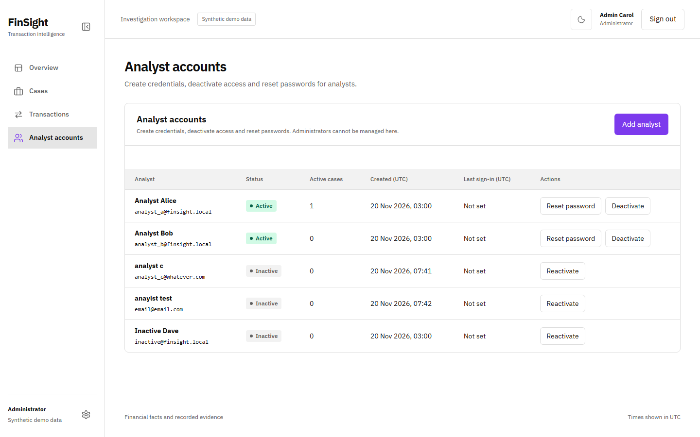

# Analyst account administration

An active administrator creates analyst credentials, deactivates an analyst, reactivates an analyst with a new password, or resets an analyst password. Deactivation blocks sign-in, revokes every session and unassigns active cases without deleting history. Administrators are not managed by this feature.

The page is `/admin/users`, linked from the sidebar only for administrators. The route calls `requirePageUser('/admin/users', 'admin')`; analysts receive `/access-denied`. The API rejects non-admin callers with `403`.

<picture>
  <source media="(prefers-color-scheme: dark)" srcset="screenshots/analyst-administration-dark.png">
  
</picture>

## Account lifecycle

| Action | Effect |
|---|---|
| Create | Adds an `app_user` row with role `analyst`, `is_active = true`, a normalized email and an Argon2id hash. Duplicate email returns `409 email_exists`. |
| Deactivate | Sets `is_active = false`, revokes every unrevoked session with `revocation_reason = 'user_disabled'`, and unassigns each `open`, `in_review` or `escalated` case. |
| Reactivate | Requires a new password, sets `is_active = true`, replaces the hash and revokes remaining sessions. |
| Reset password | Requires an active analyst, replaces the hash and revokes remaining sessions. |

Accounts are never deleted. `investigation_case.assigned_to_user_id`, `case_event.actor_user_id`, `case_command_receipt.actor_user_id` and `app_session.user_id` reference `app_user` with `ON DELETE RESTRICT`, so deletion would either fail or destroy traceability. No endpoint accepts a delete action.

Case unassignment preserves history. Each affected case receives `assigned_to_user_id = NULL`, `version = version + 1` and an `assigned` event whose `from_state` names the deactivated analyst, whose `to_state` is null and whose reason is the supplied reason or `Analyst account deactivated`. All events from one deactivation share one `operation_id` and use distinct `event_ordinal` values. Unassigned `open` cases cannot start review until an administrator assigns them through a future reassignment feature.

## API

All mutation requests require an `Origin` header that matches the configured application origin. Requests accept JSON object bodies only and reject unknown fields. Responses use `Cache-Control: private, no-store` and the shared error envelope `{ error: { code, message, fields? }, request_id }`. No response contains a password, password hash or session identifier.

| Method | Path | Body | Result |
|---|---|---|---|
| `GET` | `/api/v1/users` | None; query parameters rejected | `{ data, request_id }` with analyst accounts, newest activity first, including `active_case_count` |
| `POST` | `/api/v1/users` | `email`, `display_name`, `password` | `201` with `user_id`, normalized `email`, `display_name`, `role`, `is_active`, `created_at` |
| `PATCH` | `/api/v1/users/{id}` | `{ action: "deactivate", reason? }` | `200` with `user_id`, `is_active`, `unassigned_case_count`, `sessions_revoked` |
| `PATCH` | `/api/v1/users/{id}` | `{ action: "reactivate", password }` | `200` with `user_id`, `is_active`, `sessions_revoked` |
| `PATCH` | `/api/v1/users/{id}` | `{ action: "reset_password", password }` | `200` with `user_id`, `sessions_revoked` |

`GET` returns role `analyst` rows only. It selects no `password_hash` column. `display_name` accepts the `display_name` and `displayName` aliases; supplying both returns `400`. Email is trimmed and lowercased. Passwords require 12 to 1024 characters with no control characters and are hashed with the same Argon2id settings as sign-in.

| Status | Code | Cause |
|---|---|---|
| `400` | `invalid_request` | Malformed body, unknown field, invalid email or display name, password below 12 characters, unsupported action |
| `401` | `unauthenticated` | Missing, expired or revoked session |
| `403` | `forbidden` | Analyst or inactive administrator, cross-origin request, or a database role check failure |
| `404` | `not_found` | Target UUID does not exist |
| `409` | `email_exists` | Email already belongs to an account |
| `422` | `unprocessable_entity` | Target is not an analyst, account is already active or inactive for the requested action, or the database rejects the value |

## Database objects

`migrations/070_analyst_administration.sql` adds:

- `public.admin_audit_event` with `event_id`, `operation_id`, `actor_user_id`, `action`, `target_user_id`, `details` and `occurred_at`. Actions are `analyst_created`, `analyst_deactivated`, `analyst_reactivated` and `password_reset`. Details hold safe counts and the optional deactivation reason, never credentials.
- Triggers `admin_audit_event_immutable_stmt` and `admin_audit_event_immutable_row`, which reject `DELETE`, `TRUNCATE` and `UPDATE` with SQLSTATE `55000`.
- `public.create_analyst_account`, `public.deactivate_analyst_account`, `public.reactivate_analyst_account` and `public.reset_analyst_password`. Each is `SECURITY DEFINER` with a fixed search path and verifies that the actor is an active administrator and the target is an analyst.
- `public.grant_analyst_admin_privileges(regrole)`, which grants audit `SELECT` and the four function signatures. The runtime role receives no direct `app_user` write privilege.

Deactivation is one transaction: user lock, active-state update, session revocation, case unassignment with events, and the audit insert. A failure rolls back all of it.

## Verification

The unit suite covers payload validation and field allowlists. The API suite covers administrator-only access, cross-origin rejection, duplicate email, password non-disclosure, deactivation effects, reactivation, password reset, case unassignment, audit immutability and session revocation. Both run against an isolated PostgreSQL test database whose name ends in `_test`.

```powershell
npm run test:unit
npm run test:api
npm run typecheck
npm run build
```

The transaction-level behavior was also exercised against the synthetic demo database with rollback: create, deactivate, reactivate, audit rows, and one case unassigned from version 1 to version 2 with an `assigned` event.
