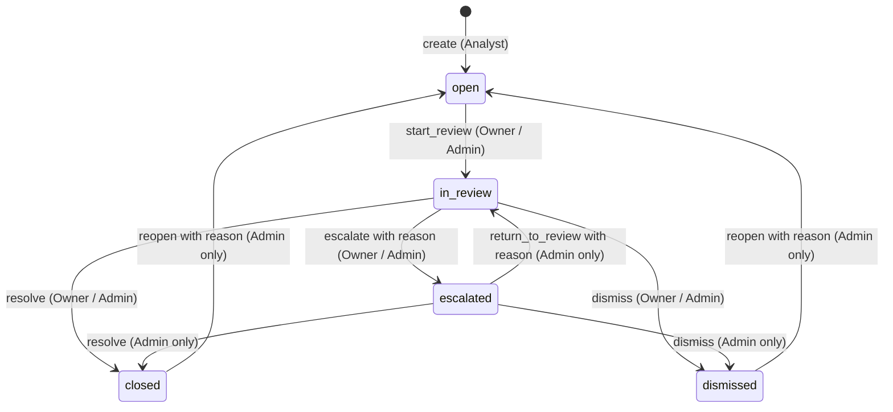

# Case Management and Lifecycle API

The Case Management API exposes authenticated endpoints for creating investigation cases, executing lifecycle state transitions under optimistic concurrency locking, reading role-scoped queue summaries, and inspecting immutable audit history.

All mutations are backed by the atomic `public.execute_case_command` PostgreSQL function (Migration 050), preserving version-based concurrency, command idempotency, role boundaries, and audit integrity. The [OpenAPI specification](api/cases.openapi.yaml) provides formal schemas and envelopes.

---

## 1. Endpoints Overview

| Method | Path | Required Role | Summary |
|---|---|---|---|
| `GET` | `/api/v1/cases` | Analyst, Admin | List cases in investigation queue (role-scoped) |
| `POST` | `/api/v1/cases` | Analyst | Create a case on a transaction with initial assignment |
| `GET` | `/api/v1/cases/{id}` | Analyst (owner), Admin | Retrieve full case detail (concealed 404 for others) |
| `PATCH` | `/api/v1/cases/{id}` | Analyst (owner), Admin | Execute an allowed lifecycle command |
| `POST` | `/api/v1/cases/{id}/commands` | Analyst (owner), Admin | Execute an allowed lifecycle command |
| `GET` | `/api/v1/cases/{id}/events` | Analyst (owner), Admin | Retrieve immutable chronological case history |

---

## 2. Authorization and Concealed 404 Policy

Access to case details and history is strictly scoped to the case owner or administrators:

- **Admins**: Have visibility over all cases in the queue and can inspect details and event history for any case.
- **Analysts**:
  - May read full details and event history **only** for cases assigned to themselves (`assigned_to_user_id = user.userId`).
  - When an analyst attempts to view details, events, or execute commands on a case assigned to another analyst, the server responds with **`404 Not Found`** ("Concealed 404"), rather than `403 Forbidden`, preventing case ID enumeration.
  - In the queue (`GET /api/v1/cases`), unassigned cases (`assigned_to_user_id IS NULL`) are projected with minimal summary fields (`case_ref`, `transaction_id`, `priority`, `status`, `due_at`), while cases assigned to other analysts are omitted completely.

---

## 3. Case Creation (`POST /api/v1/cases`)

Only active human analysts can open cases. The server sets the actor and assigns the case to the authenticated analyst automatically; forged client actor/owner fields are rejected.

**Headers:**
- `Idempotency-Key`: UUID (or supplied as `idempotency_key` in request body).

**Request Body:**
```json
{
  "transaction_id": "30000000-0000-0000-0000-000000000101",
  "priority": "high",
  "reason": "Suspicious overseas velocity spike observed across linked devices."
}
```

**Atomic Effects:**
1. Verifies that the referenced transaction exists and has no existing active (`open`, `in_review`, `escalated`) case.
2. Atomically inserts the case with `version = 1`, `status = 'open'`, and `assigned_to_user_id = user.userId`.
3. Atomically records two audit events under one `operation_id`:
   - `created` (`event_ordinal = 1`) with the creation reason in `reason` and snapshot in `to_state`.
   - `assigned` (`event_ordinal = 2`) recording assignment from `null` to the analyst.
4. Atomically records a successful receipt in `public.case_command_receipt` (`response_status = 201`).
5. Returns `201 Created` with the case summary.

---

## 4. Lifecycle Transitions and Commands

State transitions require an `expected_version` concurrency token and an `Idempotency-Key` UUID.



### Supported Commands

| Command (`action`) | Allowed Pre-Status | Allowed Roles | Required Fields | Result Status |
|---|---|---|---|---|
| `start_review` | `open` | Owner, Admin | `expected_version` | `in_review` |
| `escalate` | `in_review` | Owner, Admin | `expected_version`, `reason` (1-2,000 chars) | `escalated` |
| `return_to_review`| `escalated` | Admin only | `expected_version`, `reason` (1-2,000 chars) | `in_review` |
| `resolve` | `in_review`, `escalated`* | Owner (in_review), Admin | `expected_version`, `resolution_code = 'confirmed_suspicious'`, `resolution_notes` (1-5,000 chars) | `closed` |
| `dismiss` | `in_review`, `escalated`* | Owner (in_review), Admin | `expected_version`, `resolution_code` (`false_positive` or `insufficient_evidence`), `resolution_notes` (1-5,000 chars) | `dismissed` |
| `reopen` | `closed`, `dismissed` | Admin only | `expected_version`, `reason` (1-2,000 chars) | `open` |

*\* Note: Escalated cases can only be resolved or dismissed by an Administrator.*

### Reopening Semantics

When an admin reopens a terminal case:
1. Retains `case_id`, `case_ref`, `transaction_id`, original `opened_at`, and `priority`.
2. Sets `status = 'open'` and advances `version`.
3. Clears terminal fields: `resolution_code = NULL`, `resolution_notes = NULL`, `closed_at = NULL`, `due_at = NULL`.
4. If the previous assignee is still an active analyst, assignment is retained. If the previous assignee was deactivated or altered, assignment resets to `NULL` and an `assigned` event is emitted.
5. If another active case exists on the subject transaction, reopening is rejected with `409 Conflict`.
6. Historical terminal events and resolution rationale remain immutable in event history.

---

## 5. Optimistic Locking and Concurrency Control

Every lifecycle modification checks `expected_version`:
- The client reads the current `version` from case detail or previous command responses.
- The command request sends `expected_version`.
- PostgreSQL acquires a row lock (`FOR UPDATE`) on the case. If `v_case.version <> p_expected_version`, the transaction aborts with error code `P0409`, mapped to **`409 Conflict`** with error code `version_conflict`.
- No partial state changes, events, or receipts are committed on conflict.

---

## 6. Command Idempotency

All commands record a receipt in `public.case_command_receipt` identified by `(actor_user_id, idempotency_key)`:
- **Same key + same payload**: The prior committed result is returned with `replayed: true` (HTTP 200/201) without generating duplicate events.
- **Same key + changed payload**: PostgreSQL detects a hash mismatch and raises `P0409`, mapped to **`409 Conflict`** with error code `idempotency_conflict`.

---

## 7. Event Immutability and Least-Privilege Grants

- Runtime application roles (`finsight_runtime`, `finsight_app`) are granted `SELECT` on `public.investigation_case` and `public.case_event`, and `EXECUTE` on `public.execute_case_command`.
- Direct `INSERT`, `UPDATE`, or `DELETE` on `case_event` and `case_command_receipt` is revoked from all runtime roles.
- Triggers `case_event_immutable_stmt` and `case_event_immutable_row` reject any modification to historical event records with error code `55000`.

---

## 8. Verification Traceability (VS06 - VS15)

The test suite in [`tests/api/cases.test.ts`](../tests/api/cases.test.ts) exercises the complete verification matrix against a live PostgreSQL 17 test cluster:

| Test ID | Slice Scope | Verified Behavior |
|---|---|---|
| **VS06** | Case Creation | 201 Created; atomically emits `created` and `assigned` events under one operation ID. |
| **VS07** | Idempotency & Concurrency | Same-key retry returns `replayed: true`; changed payload returns 409; competing creations leave one active case. |
| **VS08** | Ownership & Authorization | Private case detail/history yields concealed 404; admin-only action by analyst yields 403; forged actor ignored. |
| **VS09** | Validation & State Guards | Open-to-terminal, blank reasons, invalid codes return 422/400; DB function rejects equivalent direct calls. |
| **VS10** | Review & Escalation Journey | Review -> Escalation -> Admin Return; reason stored in dedicated field; analyst escalated resolution denied. |
| **VS11** | Parameterized Resolution | All three resolution codes (`confirmed_suspicious`, `false_positive`, `insufficient_evidence`) tested and verified. |
| **VS12** | Reopening Contract | Admin reopens terminal case; active owner retained; inactive owner reset to null via `assigned` event. |
| **VS13** | Reopen Conflicts | Analyst reopen denied (403); competing active case on subject rejects reopen (409). |
| **VS14** | Concurrency Race | Competing commands on same `expected_version` resolve with one 200 and one 409 conflict. |
| **VS15** | Immutability & Privileges | Direct event mutations denied under runtime role; immutability trigger blocks table updates. |
