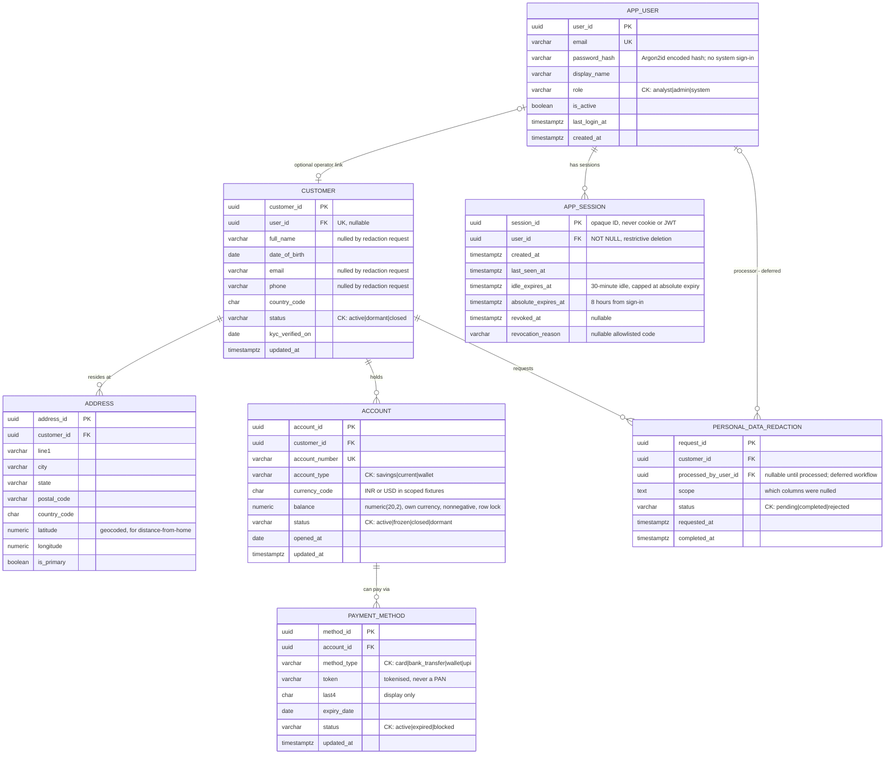
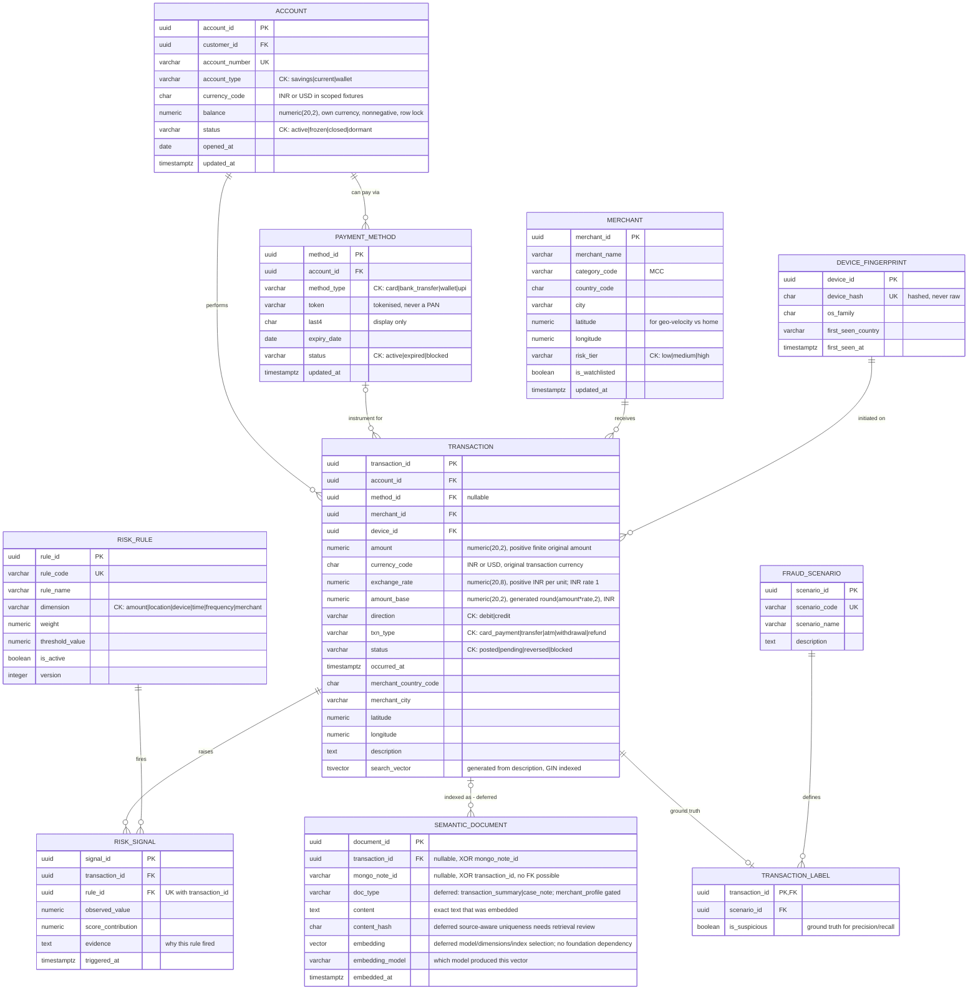
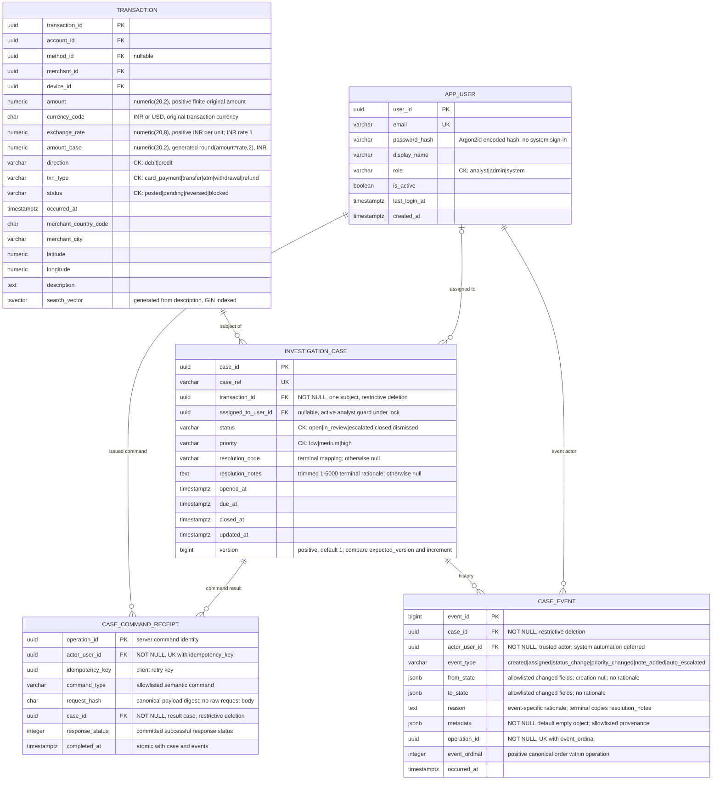

# FinSight ER design and relational mapping

The [full Mermaid source](er-diagram.mmd) defines the structural inventory. This document maps it to the workflow contracts and report figures. The [financial baseline](financial-baseline.md) records the implemented migration 010 boundary; operational tables, behavior and deferred entities below remain designs.

## Authority, scope and review

The [case/authentication contract](case-auth-contracts.md) and [case-event contract](product-workflows.md#case-event-contract) own session policy, command authorization, event shapes and concurrency. The [INR contract](architecture-gaps.md#reporting-currency-contract) owns precision and conversion. The [risk contract](risk-formula-contract.md) owns deterministic synthetic rule semantics.

Issue #3's contract review is recorded in [PR #22](https://github.com/KadakWNL/finsight/pull/22). These ER refinements require ShrikarDesai07 cross-review under [issue #1](https://github.com/KadakWNL/finsight/issues/1) before financial/operational DDL starts. Publication or generated figures do not constitute approval or implementation. This document does not record teammate sign-off.

The first slice includes operator identities/sessions, synthetic card-payment facts, risk signals, case lifecycle/history and successful command receipts. `SEMANTIC_DOCUMENT` and `PERSONAL_DATA_REDACTION` are deferred design vocabulary. Notes, auto-escalation, priority mutation and general operator/rule mutations stay gated. The session-cleanup record belongs to the separate [PR #24](https://github.com/KadakWNL/finsight/pull/24) contract and migration 060, not this foundational ER revision.

PlantUML is an explicitly stale historical draft and must not be used for implementation or report figures. [Historical design notes](er-design-history.md) preserve earlier reasoning; the source and contracts above resolve conflicts.

## Figure 1: Identity and banking

[SVG](er-diagram-1-identity-banking.svg) | [JPG](er-diagram-1-identity-banking.jpg) | [Mermaid source](er-diagram-1-identity-banking.mmd)



## Figure 2: Transactions and risk

[SVG](er-diagram-2-transactions-risk.svg) | [JPG](er-diagram-2-transactions-risk.jpg) | [Mermaid source](er-diagram-2-transactions-risk.mmd)



## Figure 3: Investigation

[SVG](er-diagram-3-investigation.svg) | [JPG](er-diagram-3-investigation.jpg) | [Mermaid source](er-diagram-3-investigation.mmd)



## Relational mapping and integrity

| Relationship | Cardinality and mapping | Required integrity |
|---|---|---|
| Operator/customer | Zero or one on each side; nullable unique `CUSTOMER.user_id` | Optional record link grants no customer sign-in |
| Customer/address/account | Each address/account has one customer; customer has many | Mandatory restrictive FKs; primary-address uniqueness is a later reviewed constraint |
| Account/payment method/transaction | Each method/transaction has one account; account has many | Mandatory restrictive parent FKs; nonnegative balance and coordinated row locks |
| Method/transaction | Transaction has zero or one method; method has many transactions | Nullable method; composite FK `(method_id, account_id)` to a unique method/account pair |
| Merchant/device/transaction | Each scoped card payment has one merchant and one device | Mandatory parent references; other transaction-type semantics remain unimplemented |
| Transaction/signals/rules | Each signal has one transaction and one rule | Unique `(transaction_id, rule_id)`; immutable once-only evidence |
| Transaction/case | Each case has exactly one subject; transaction has many historical cases | Nonnull restrictive FK; partial unique index allows at most one nonterminal case |
| Operator/case | Case has zero or one assignee; analyst may own many | Active analyst validation under coordinated locks; admins cannot be assignees |
| Case/event/actor | Event has exactly one case and one actor | Nonnull restrictive FKs; actor server-derived; no direct runtime event writes |
| Operator/session | Session has exactly one operator; operator has many sessions | Restrictive FK; encrypted-cookie verification plus server-side revocation/expiry/current role |
| Operator/receipt/case | Each successful receipt has one actor and one result case | Unique actor/idempotency key; operation primary key; mutation/events/receipt commit atomically |
| Transaction/semantic document | Transaction has many derived documents; each document has zero or one transaction source | Deferred source XOR/type/provenance validation; no foundation vector dependency |
| Customer/redaction/processor | Request has one customer and zero or one processor | Deferred reviewed redaction workflow; never financial cascade deletion |
| Transaction/label/scenario | Transaction has zero or one label; label has one scenario | Synthetic evaluation-only data excluded from investigator responses |

Case `version` starts at 1 and stays positive. Every successful mutation of an existing case checks `expected_version` under lock and increments it atomically. `updated_at` is informational. A stale command changes neither case nor events nor successful receipt. Exact request/response behavior belongs to the case/auth contract.

Resolution is fixed: `confirmed_suspicious` maps to `closed`; `false_positive` and `insufficient_evidence` map to `dismissed`. Terminal rows require validated notes and `closed_at`; nonterminal rows have null outcome fields. Reopen preserves identity, original opening time, priority and history, clears outcome/time/due fields, and retains only an active analyst assignee.

Events use allowlisted persistent-field snapshots. Rationale lives only in `reason`, with terminal rationale copied from validated resolution notes. `metadata` is nonnull JSONB default `{}` and uses event-specific allowlists. Unique `(operation_id, event_ordinal)` identifies logical events; positive contiguous ordinals encode canonical command order. Creation records an unassigned snapshot before `assigned`; reopen records `status_change` before any inactive-owner reset.

`APP_SESSION` expiry and revocation timestamps are server-generated. Its session ID is an opaque row identifier, never a stored cookie/JWT. Receipt hashes cover canonical command payloads; receipts contain no unrestricted body or credential. Primary-key selection for receipt `operation_id` is a structural refinement for this review; it does not replace actor/key uniqueness.

## Field inventory

The following dictionary is derived from the canonical source. Mermaid comments describe design checks; actual migration constraints still need implementation and negative SQL tests.

<!-- BEGIN FIELD INVENTORY -->
### `APP_USER`

| Field | Type | Key / design notes |
|---|---|---|
| `user_id` | `uuid` | PK |
| `email` | `varchar` | UK |
| `password_hash` | `varchar` | Argon2id encoded hash; no system sign-in |
| `display_name` | `varchar` | See entity contract |
| `role` | `varchar` | CK: analyst\|admin\|system |
| `is_active` | `boolean` | See entity contract |
| `last_login_at` | `timestamptz` | See entity contract |
| `created_at` | `timestamptz` | See entity contract |

### `CUSTOMER`

| Field | Type | Key / design notes |
|---|---|---|
| `customer_id` | `uuid` | PK |
| `user_id` | `uuid` | FK; UK, nullable |
| `full_name` | `varchar` | nulled by redaction request |
| `date_of_birth` | `date` | See entity contract |
| `email` | `varchar` | nulled by redaction request |
| `phone` | `varchar` | nulled by redaction request |
| `country_code` | `char` | See entity contract |
| `status` | `varchar` | CK: active\|dormant\|closed |
| `kyc_verified_on` | `date` | See entity contract |
| `updated_at` | `timestamptz` | See entity contract |

### `ADDRESS`

| Field | Type | Key / design notes |
|---|---|---|
| `address_id` | `uuid` | PK |
| `customer_id` | `uuid` | FK |
| `line1` | `varchar` | See entity contract |
| `city` | `varchar` | See entity contract |
| `state` | `varchar` | See entity contract |
| `postal_code` | `varchar` | See entity contract |
| `country_code` | `char` | See entity contract |
| `latitude` | `numeric` | geocoded, for distance-from-home |
| `longitude` | `numeric` | See entity contract |
| `is_primary` | `boolean` | See entity contract |

### `ACCOUNT`

| Field | Type | Key / design notes |
|---|---|---|
| `account_id` | `uuid` | PK |
| `customer_id` | `uuid` | FK |
| `account_number` | `varchar` | UK |
| `account_type` | `varchar` | CK: savings\|current\|wallet |
| `currency_code` | `char` | INR or USD in scoped fixtures |
| `balance` | `numeric` | numeric(20,2), own currency, nonnegative, row lock |
| `status` | `varchar` | CK: active\|frozen\|closed\|dormant |
| `opened_at` | `date` | See entity contract |
| `updated_at` | `timestamptz` | See entity contract |

### `PAYMENT_METHOD`

| Field | Type | Key / design notes |
|---|---|---|
| `method_id` | `uuid` | PK |
| `account_id` | `uuid` | FK |
| `method_type` | `varchar` | CK: card\|bank_transfer\|wallet\|upi |
| `token` | `varchar` | tokenised, never a PAN |
| `last4` | `char` | display only |
| `expiry_date` | `date` | See entity contract |
| `status` | `varchar` | CK: active\|expired\|blocked |
| `updated_at` | `timestamptz` | See entity contract |

### `MERCHANT`

| Field | Type | Key / design notes |
|---|---|---|
| `merchant_id` | `uuid` | PK |
| `merchant_name` | `varchar` | See entity contract |
| `category_code` | `varchar` | MCC |
| `country_code` | `char` | See entity contract |
| `city` | `varchar` | See entity contract |
| `latitude` | `numeric` | for geo-velocity vs home |
| `longitude` | `numeric` | See entity contract |
| `risk_tier` | `varchar` | CK: low\|medium\|high |
| `is_watchlisted` | `boolean` | See entity contract |
| `updated_at` | `timestamptz` | See entity contract |

### `DEVICE_FINGERPRINT`

| Field | Type | Key / design notes |
|---|---|---|
| `device_id` | `uuid` | PK |
| `device_hash` | `char` | UK; hashed, never raw |
| `os_family` | `char` | See entity contract |
| `first_seen_country` | `varchar` | See entity contract |
| `first_seen_at` | `timestamptz` | See entity contract |

### `TRANSACTION`

| Field | Type | Key / design notes |
|---|---|---|
| `transaction_id` | `uuid` | PK |
| `account_id` | `uuid` | FK |
| `method_id` | `uuid` | FK; nullable |
| `merchant_id` | `uuid` | FK |
| `device_id` | `uuid` | FK |
| `amount` | `numeric` | numeric(20,2), positive finite original amount |
| `currency_code` | `char` | INR or USD, original transaction currency |
| `exchange_rate` | `numeric` | numeric(20,8), positive INR per unit; INR rate 1 |
| `amount_base` | `numeric` | numeric(20,2), generated round(amount*rate,2), INR |
| `direction` | `varchar` | CK: debit\|credit |
| `txn_type` | `varchar` | CK: card_payment\|transfer\|atm\|withdrawal\|refund |
| `status` | `varchar` | CK: posted\|pending\|reversed\|blocked |
| `occurred_at` | `timestamptz` | See entity contract |
| `merchant_country_code` | `char` | See entity contract |
| `merchant_city` | `varchar` | See entity contract |
| `latitude` | `numeric` | See entity contract |
| `longitude` | `numeric` | See entity contract |
| `description` | `text` | See entity contract |
| `search_vector` | `tsvector` | generated from description, GIN indexed |

### `RISK_RULE`

| Field | Type | Key / design notes |
|---|---|---|
| `rule_id` | `uuid` | PK |
| `rule_code` | `varchar` | UK |
| `rule_name` | `varchar` | See entity contract |
| `dimension` | `varchar` | CK: amount\|location\|device\|time\|frequency\|merchant |
| `weight` | `numeric` | See entity contract |
| `threshold_value` | `numeric` | See entity contract |
| `is_active` | `boolean` | See entity contract |
| `version` | `integer` | See entity contract |

### `RISK_SIGNAL`

| Field | Type | Key / design notes |
|---|---|---|
| `signal_id` | `uuid` | PK |
| `transaction_id` | `uuid` | FK |
| `rule_id` | `uuid` | FK; UK with transaction_id |
| `observed_value` | `numeric` | See entity contract |
| `score_contribution` | `numeric` | See entity contract |
| `evidence` | `text` | why this rule fired |
| `triggered_at` | `timestamptz` | See entity contract |

### `SEMANTIC_DOCUMENT`

| Field | Type | Key / design notes |
|---|---|---|
| `document_id` | `uuid` | PK |
| `transaction_id` | `uuid` | FK; nullable, XOR mongo_note_id |
| `mongo_note_id` | `varchar` | nullable, XOR transaction_id, no FK possible |
| `doc_type` | `varchar` | deferred: transaction_summary\|case_note; merchant_profile gated |
| `content` | `text` | exact text that was embedded |
| `content_hash` | `char` | deferred source-aware uniqueness needs retrieval review |
| `embedding` | `vector` | deferred model/dimensions/index selection; no foundation dependency |
| `embedding_model` | `varchar` | which model produced this vector |
| `embedded_at` | `timestamptz` | See entity contract |

### `INVESTIGATION_CASE`

| Field | Type | Key / design notes |
|---|---|---|
| `case_id` | `uuid` | PK |
| `case_ref` | `varchar` | UK |
| `transaction_id` | `uuid` | FK; NOT NULL, one subject, restrictive deletion |
| `assigned_to_user_id` | `uuid` | FK; nullable, active analyst guard under lock |
| `status` | `varchar` | CK: open\|in_review\|escalated\|closed\|dismissed |
| `priority` | `varchar` | CK: low\|medium\|high |
| `resolution_code` | `varchar` | terminal mapping; otherwise null |
| `resolution_notes` | `text` | trimmed 1-5000 terminal rationale; otherwise null |
| `opened_at` | `timestamptz` | See entity contract |
| `due_at` | `timestamptz` | See entity contract |
| `closed_at` | `timestamptz` | See entity contract |
| `updated_at` | `timestamptz` | See entity contract |
| `version` | `bigint` | positive, default 1; compare expected_version and increment |

### `CASE_EVENT`

| Field | Type | Key / design notes |
|---|---|---|
| `event_id` | `bigint` | PK |
| `case_id` | `uuid` | FK; NOT NULL, restrictive deletion |
| `actor_user_id` | `uuid` | FK; NOT NULL, trusted actor; system automation deferred |
| `event_type` | `varchar` | created\|assigned\|status_change\|priority_changed\|note_added\|auto_escalated |
| `from_state` | `jsonb` | allowlisted changed fields; creation null; no rationale |
| `to_state` | `jsonb` | allowlisted changed fields; no rationale |
| `reason` | `text` | event-specific rationale; terminal copies resolution_notes |
| `metadata` | `jsonb` | NOT NULL default empty object; allowlisted provenance |
| `operation_id` | `uuid` | NOT NULL, UK with event_ordinal |
| `event_ordinal` | `integer` | positive canonical order within operation |
| `occurred_at` | `timestamptz` | See entity contract |

### `APP_SESSION`

| Field | Type | Key / design notes |
|---|---|---|
| `session_id` | `uuid` | PK; opaque ID, never cookie or JWT |
| `user_id` | `uuid` | FK; NOT NULL, restrictive deletion |
| `created_at` | `timestamptz` | See entity contract |
| `last_seen_at` | `timestamptz` | See entity contract |
| `idle_expires_at` | `timestamptz` | 30-minute idle, capped at absolute expiry |
| `absolute_expires_at` | `timestamptz` | 8 hours from sign-in |
| `revoked_at` | `timestamptz` | nullable |
| `revocation_reason` | `varchar` | nullable allowlisted code |

### `CASE_COMMAND_RECEIPT`

| Field | Type | Key / design notes |
|---|---|---|
| `operation_id` | `uuid` | PK; server command identity |
| `actor_user_id` | `uuid` | FK; NOT NULL, UK with idempotency_key |
| `idempotency_key` | `uuid` | client retry key |
| `command_type` | `varchar` | allowlisted semantic command |
| `request_hash` | `char` | canonical payload digest; no raw request body |
| `case_id` | `uuid` | FK; NOT NULL, result case, restrictive deletion |
| `response_status` | `integer` | committed successful response status |
| `completed_at` | `timestamptz` | atomic with case and events |

### `PERSONAL_DATA_REDACTION`

| Field | Type | Key / design notes |
|---|---|---|
| `request_id` | `uuid` | PK |
| `customer_id` | `uuid` | FK |
| `processed_by_user_id` | `uuid` | FK; nullable until processed; deferred workflow |
| `scope` | `text` | which columns were nulled |
| `status` | `varchar` | CK: pending\|completed\|rejected |
| `requested_at` | `timestamptz` | See entity contract |
| `completed_at` | `timestamptz` | See entity contract |

### `FRAUD_SCENARIO`

| Field | Type | Key / design notes |
|---|---|---|
| `scenario_id` | `uuid` | PK |
| `scenario_code` | `varchar` | UK |
| `scenario_name` | `varchar` | See entity contract |
| `description` | `text` | See entity contract |

### `TRANSACTION_LABEL`

| Field | Type | Key / design notes |
|---|---|---|
| `transaction_id` | `uuid` | PK,FK |
| `scenario_id` | `uuid` | FK |
| `is_suspicious` | `boolean` | ground truth for precision/recall |

<!-- END FIELD INVENTORY -->

## SQL objects outside the ER

| Object | Planned scope and behavior |
|---|---|
| `uq_case_open_per_transaction` | Partial unique index on case subject where status is not closed/dismissed |
| `uq_risk_signal_per_rule` | Unique transaction/rule signal pair |
| Method/account key and FK | Prevent an instrument on a different account |
| Session and receipt indexes | User/active-session lookup; actor/key receipt lookup and operation primary key |
| `v_transaction_risk` | Left-join transactions to signals; coalesce score/count to zero; fixed bands |
| Financial indexes | Account/time and cursor order; FK coverage verified by actual plans |
| `trg_case_event_immutable` | Reject event UPDATE/DELETE even with granted table privileges |
| Guarded case functions | One writer for case state/events/receipts; current authority, safe search path, narrow EXECUTE grants |
| `trg_touch_updated_at` | Only tables with an approved timestamp field; not concurrency authority |
| Balance guards | Nonnegative check plus row-locked ingestion; no operator financial mutation |
| FTS, vector indexes/materialized views | Reviewed workload-specific expansion; vector model/dimensions selected at retrieval |
| Redaction trigger/function | Deferred redesign for SQL-first per-store recovery; not a completion-trigger erase |

A generic `trg_case_audit` must not duplicate the protected function's events. Revoke runtime direct case/event writes and grant only approved functions. Separate migrator, app and scoped service roles; runtime credentials are never owner/superuser. The [development contract](development-and-testing-contract.md#2-sql-migration-contract) owns migration order and privilege-test conventions.

A proposed aggregation illustrates zero-signal preservation; it is not an applied view:

```sql
SELECT t.transaction_id,
       COALESCE(SUM(s.score_contribution), 0) AS risk_score,
       COUNT(s.signal_id) AS signal_count,
       CASE
         WHEN COALESCE(SUM(s.score_contribution), 0) >= 80 THEN 'critical'
         WHEN COALESCE(SUM(s.score_contribution), 0) >= 60 THEN 'high'
         WHEN COALESCE(SUM(s.score_contribution), 0) >= 35 THEN 'medium'
         ELSE 'low'
       END AS risk_band
FROM transaction t
LEFT JOIN risk_signal s ON s.transaction_id = t.transaction_id
GROUP BY t.transaction_id;
```

Zero signals displays "No recorded signals"; it does not prove safe or evaluated. Monetary values use decimal strings across APIs. Store positive finite original amounts/rates, require INR rate 1, generate rounded INR base amounts, and keep account balances in their own currency.

## Deferred cross-store and retrieval boundaries

PostgreSQL owns relational facts, operational authority, risk evidence and immutable case history. MongoDB's approved academic scope is heterogeneous synthetic telemetry reads/aggregation after MVP acceptance. Analyst-note writes need durable intent, confirmation, recovery and authorization before exposure.

A semantic document's source XOR checks populated references only; it cannot prove a Mongo document exists or is authorized. Select model/dimensions, source-aware deduplication and source authorization together at retrieval. Merchant-profile embeddings remain gated until a real merchant source is designed. Neither `vector(384)` nor an HNSW index is a foundational requirement.

Financial facts and case/risk history have restrictive deletion boundaries. Synthetic ground-truth labels are evaluation inputs, never rule predicates or investigator answers. This design revision grants no redaction, export or general cleanup operation.

## Reproduce and verify figures

Run `python scripts/render_er.py --write` to derive split Mermaid sources, fenced figures and the field inventory. Run `python scripts/render_er.py --check` to verify synchronization and the contract invariants. The helper uses only the Python standard library for those commands.

To render SVG/JPG, install Pillow and run `python scripts/render_er.py --render --browser /absolute/path/to/chrome`. Rendering uses pinned Mermaid CLI 11.12.0 through npx and an existing Chromium executable. The helper writes SVGs and uses temporary PNGs to produce white-background JPGs. Node/npm, network access for the renderer package and Chromium are rendering prerequisites only; they are not application dependencies.

Full report overview: [SVG](er-diagram.svg) and [JPG](er-diagram.jpg). Split figures are preferable for readable report pages. The local academic PDF is not redistributed.
