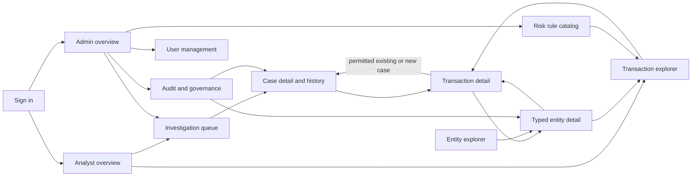

# Information architecture

FinSight navigation follows discovery, investigation, and oversight tasks. All routes below are proposed; no Next.js routes exist. [Product workflows](product-workflows.md#permission-contract) owns permissions, and [architecture gaps](architecture-gaps.md) owns implementation status.

## Role-specific navigation

| Surface | Analyst navigation | Admin navigation |
|---|---|---|
| Main | Overview, Transactions, Cases, Entities | Overview, Transactions, Cases, Entities |
| Administration | None | Users, Risk rules, Audit and governance |
| Account menu | Display name, role, sign out | Display name, role, sign out |
| Contextual links | Owned case history; rule explanation from a signal | All case history; rule catalog and governance links |

The service actor has no interactive navigation. Entities is a typed explorer, not a separate database entity. Risk rules is initially read-only. User mutations and redaction processing are visible as proposed implementation targets and must remain unavailable until audit/recovery prerequisites exist.

The [first vertical slice](requirements-traceability.md#first-vertical-slice-and-acceptance-tests) delivers analyst Overview, Transactions, and Cases, plus admin case oversight through Overview and Cases. Entity pages and administrative catalogs enter only when their data contracts are delivered. Omit navigation to unimplemented screens rather than presenting functional-looking links. Keep the full role navigation above as the target architecture.

Admin resolution/return/reopen on case detail belongs to the guarded case lifecycle. Operator account changes, rule edits, and redaction belong to separate [capability gates](architecture-gaps.md#capability-gates). A working admin overview grants no implicit access to those mutation workflows.

Desktop navigation uses a left rail with a clear active item. Admin entries form a labeled secondary group. Compact layouts use a menu drawer, preserve the active page title, and return focus to the menu trigger when closed. Deep links receive the same server authorization as in-app navigation.

## Page inventory

Each row describes a proposed screen and the documented entities that justify it. Wireframes and per-screen states live in [UI/UX specification](ui-ux-specification.md#screen-specifications).

| ID / proposed route | Purpose and primary user | Primary and secondary actions | Data displayed | Filters, search, sort | Destinations / restrictions |
|---|---|---|---|---|---|
| S01 `/sign-in` | Authenticate human operators | Sign in; retry; return to safe previous route | Credential form; generic result | None | `/overview` or `/admin`; no service sign-in |
| S02 `/overview` | Analyst chooses next work | Open owned due/priority case; inspect flagged transaction | Authorized case work list; transactions with recorded high/critical signals | Owned cases; risk band; date window; due/priority order | Case or transaction detail; analyst only |
| S03 `/transactions` | Human operator locates transaction | Apply query/open transaction; reset filters | Transaction facts plus aggregate risk and permitted case indicator | Description full text or exact UUID; date, status, risk, account, merchant, amount/currency; allowed column sort | Transaction, account, merchant; both human roles |
| S04 `/transactions/[transaction_id]` | Explain transaction and decide investigation | Open/create case; compare related activity; inspect rule | Facts, signals, risk total, related entities, permitted case links | Related activity date window; signal contribution order | Cases, typed entity details, rule context; case link redacted by policy |
| S05 `/cases` | Analyst executes own work; admin dispatches | Open case; admin assign/reassign; filter queue | `case_ref`, status, priority, due, subject, allowed owner | Mine/unassigned for analyst; all/owner/escalated for admin; status/priority/due; case ref; due or updated order | Case, transaction; analyst unassigned row remains summary-only |
| S06 `/cases/[case_id]` | Investigate and record an accountable outcome | Start review, escalate, code-derived resolve/dismiss; admin return/reopen; note/priority/assignment in later scopes | Case state, subject facts, signals; event state diffs, dedicated rationale, provenance; confirmed notes when delivered | History event type/actor/date; chronological sort; notes tab later | Transaction/context; only own cases or admin; resolution/reset contract in workflows |
| S07 `/entities` | Discover related account/customer/merchant/device | Select type/search; open entity | Typed list with identity/status fields | Type; exact ID; account suffix, customer name, merchant name, device hash prefix where approved | S08; masked fields; bounded prefix searches |
| S08 `/entities/[type]/[entity_id]` | Compare related financial activity | Open related transaction; navigate relationships | Type-specific attributes; related activity and documented summaries | Date/status/risk; occurred-time order | Customer/accounts, merchant/device transactions; both human roles |
| S09 `/admin` | Admin identifies governance work | Assign unowned work; review escalation/request | Queue summaries, pending redaction count, inactive operators, optional dependency status | Priority/due, request age; links carry query | Cases, users, governance; admin only |
| S10 `/admin/users` | Maintain operator access | View operator; proposed create/edit/deactivate | `APP_USER` human records, role, activity, last login, active assignment counts | Role, active, email/display name; display name or last login sort | User edit sheet and assignment queue; admin only; system rows protected |
| S11 `/admin/rules` | Inspect detection configuration | Open rule and affected transactions; proposed editing | `rule_code`, name, dimension, weight, threshold, version, activity | Dimension/activity; code/name; code or dimension sort | Rule detail subpanel, filtered transactions; admin only |
| S12 `/admin/governance` | Inspect history and handle redaction | Open event/request; proposed submit/process/reject | `CASE_EVENT` joined case/actor; `PERSONAL_DATA_REDACTION`; general audit explicitly proposed | Tabs, event/date/actor/case; request status/customer; time order | Case detail, masked customer, request dialog; admin only |
| S13 `/access-denied` | Recover from blocked action | Navigate to permitted overview; sign out | Clear permission message without private record data | None | Role landing page; authenticated human |

No independent account, merchant, device, customer, or payment-method mutation pages are scoped. Payment methods appear under account/transaction detail. No customer portal, decorative analytics page, attachment manager, or standalone health screen is justified. General audit and rule edit subflows remain proposals with gates.

## Page states

This table owns page-level orchestration. Component behavior and messages are specified in the UX document; backend errors are specified in traceability.

| Page | Loading | Empty | Failure/access | Success |
|---|---|---|---|---|
| S01 | Disable repeated sign-in | Blank fields with instructions | Generic credential failure; retry after rate limit | Safe route or role landing |
| S02 | Work-list skeletons | No owned cases; link to discovery | Failed section reports its own error; no zero substitutes | Real authorized lists, timestamped fetch |
| S03 | Table skeleton retaining filters | Dataset empty or no filter matches | Query error with retry; invalid filter near field | Bounded results, query reflected in URL |
| S04 | Header and fact skeleton | No signals/related activity | Not found for absent transaction; per-panel related-data failure | Explanation and permitted case actions |
| S05 | Queue skeleton | No mine/unassigned/all matches | List retry; denied assignment keeps selection | Updated queue/owner after confirmed action |
| S06 | Detail skeleton | No notes/events shown as distinct states; note capability unavailable in first slice | Unauthorized private case uses concealed not-found result; conflict retains draft | Mutation updates derived terminal state and appends typed event; reopen keeps historical outcome |
| S07 | Typed list skeleton | No entities or no matches | Invalid entity type rejected; query retry | Selected type remains in URL |
| S08 | Fact/activity skeleton | No related transactions | Missing entity; nullable attribute “Not recorded”; Mongo panel failure | Links and aggregates scoped to selected entity |
| S09 | Independent work sections | No escalations/requests | Dependency unavailable is distinct from checked healthy | Task links with current counts |
| S10 | Operator table skeleton | No matching operators | Audit unavailable blocks edits; conflict keeps form | Changes visible after server confirmation |
| S11 | Rule table skeleton | No configured rules | Read failure; historical config unavailable label | Read-only catalog or validated revision after future gate |
| S12 | Tab skeletons | No events or no pending requests | Missing general audit labeled unavailable; pending redaction step warns | Request status only completed after cross-store confirmation |
| S13 | Minimal static shell | Not applicable | No restricted content or IDs in message | Permitted navigation works |

## Screen relationships

## Search and navigation behavior

Transaction search defaults to PostgreSQL full text over `TRANSACTION.description`; exact transaction IDs are recognized separately. Entity search is typed and parameterized. Case search uses `case_ref`. There is no single search box pretending all datasets share one index.

Semantic retrieval is a labeled optional mode within the transaction explorer, not a new page. Transaction summary hits open transaction detail. Confirmed note hits open a permitted case with the note selected. Restricted note text, counts, and existence are removed before the response. This mode requires the source/revision consistency gates in the architecture document.

URL parameters hold nonsensitive filters, sort, selected entity type, and cursor. Avoid copying sensitive narrative text into URLs, analytics, or browser history; sensitive search terms use a protected request body with an ephemeral query handle if needed. The exact transport choice is unresolved. Changing filter/sort resets the cursor. Back restores the previous list context and scroll where possible.

Breadcrumbs express source context, such as Cases > Case reference or Entities > Account. The transaction subject link returns to the retained explorer query. IDs remain copyable with an accessible label; masked account numbers are not complete identifiers.

Server navigation checks the authenticated role before issuing page data queries. Unauthenticated users go to sign-in with a safe local return route. Unknown entity types return not found. Known admin areas return access denied for analysts; private case IDs return not found to conceal case details.

Event history separates “Field changes”, “Reason”, and “Evidence reference”. Creation, escalation, and reopening reasons come from the dedicated event rationale field. Prior resolution is found in the original terminal event, whose outcome remains available after reopening. Neither user-facing history nor query APIs treat state JSON as arbitrary metadata.
