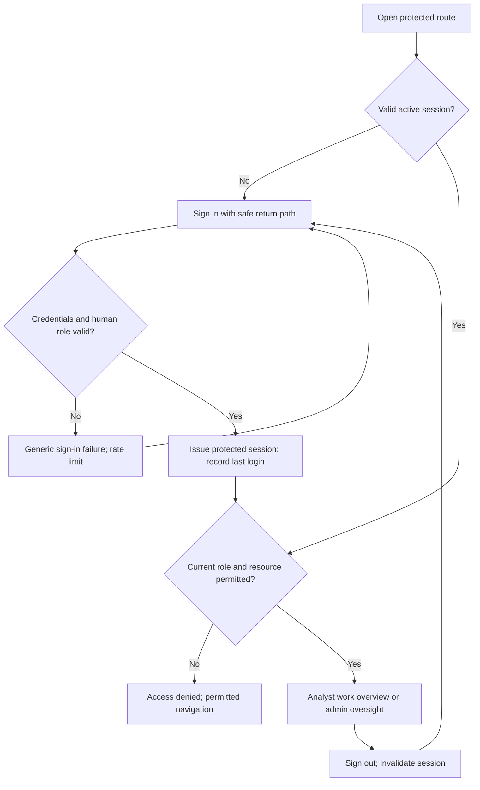
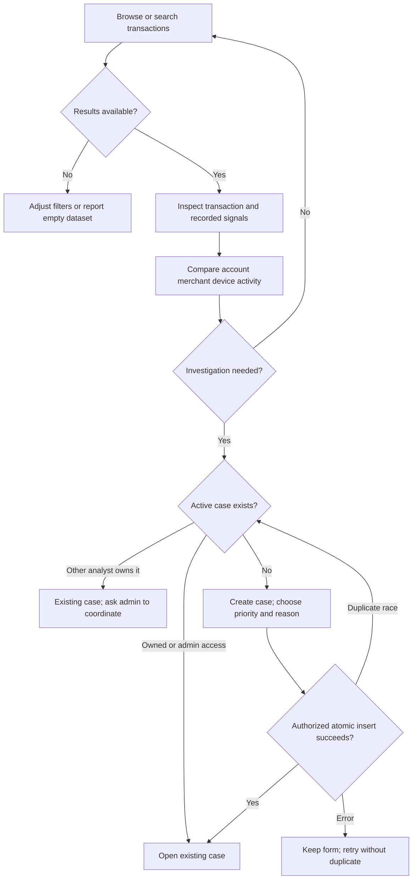
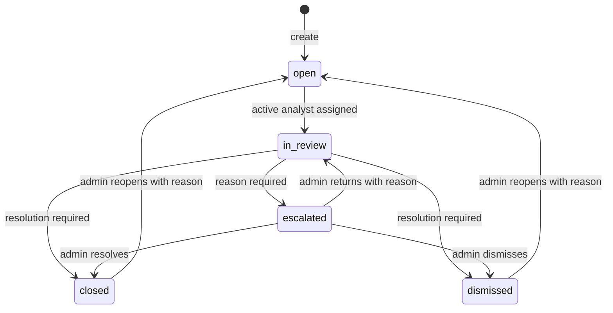
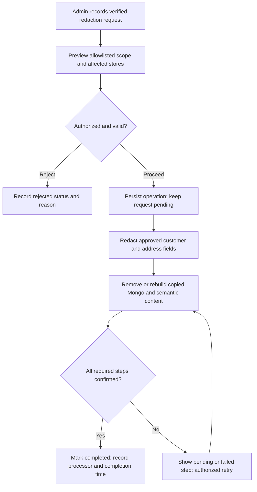

# Product workflows

FinSight helps internal operators investigate suspicious synthetic financial transactions using explainable signals and traceable cases. Every workflow here is a proposed contract; the repository contains design artifacts only. [Architecture assessment](architecture-gaps.md#evidence-and-inspection-boundary) owns the evidence and implementation status.

## Scope and user decisions

The [README](../README.md) establishes synthetic data, investigation, and a two-member academic project. The [ER source](er-diagram.mmd) supports operator identities, financial entities, risk signals, and case history. It does not establish customer self-service, payment execution, account freezing commands, regulatory reporting, or funds recovery.

| Actor | Objective and decisions | Data needed | Allowed work |
|---|---|---|---|
| Analyst | Decide which transaction needs investigation; explain signals; conclude assigned reviews or escalate uncertainty | Transaction facts, related activity, signal evidence, own case notes/history | Search facts, open own case, investigate owned cases, record evidence, change allowed states |
| Admin | Dispatch work, review escalations, maintain operator access, govern configuration and redaction | All cases/events, operator status, pending redaction requests, rules | Assign, oversee, handle escalations/reopening; proposed audited admin controls |
| System/service | Ingest synthetic records, evaluate rules, derive search data, retry confirmed operations | Valid source inputs, active rules, SQL/Mongo provenance | Explicit service operations with recorded `APP_USER` system actor where applicable |

`APP_USER.role` is a single value: `analyst`, `admin`, or `system`. `system` is a service identity, not a third interactive role. The `CUSTOMER.user_id` optional relationship provides no customer permission. There is no tenant, team, or role-permission entity.

## Permission contract

This proposed policy is enforced in backend services and every API handler. UI affordances reflect the result. SQL connection roles are infrastructure privileges, distinct from `APP_USER.role`. The application never derives the actor, role, or ownership from a client body.

Analysts can read organization-wide transaction/entity facts to discover patterns. Direct identifiers are masked by default. Case details and notes are restricted to owned cases. Unassigned queue summaries expose case reference, subject transaction, priority, status, and due time. Another analyst's case exposes only an “Existing case” indicator through transaction detail; it does not expose notes, owner identity, or case resolution.

This balances discovery with confidentiality. The schema has no case membership table, so peer access would require a deliberate additional policy or relationship. Admins read all cases for supervision. All operations recheck the current active user and resource state, including semantic search and direct URL requests.

| Record/action | Analyst | Admin | System/service | Restriction/audit |
|---|---|---|---|---|
| View transactions/accounts/customers/merchants/devices | Masked facts across dataset | Same masked default | Needed by scoped processing | No `password_hash`, payment `token`, or raw request secrets in responses |
| View case/event/note details | Own assigned cases | All cases | Only scoped jobs | Authorization through current `assigned_to_user_id`; redact sensitive payloads |
| Browse cases | Own details; minimal unassigned summaries | All | Job scope | No other-owner summaries or totals for analyst |
| Create case | For any visible transaction, assigned to self | Assigned to active analyst or unassigned | Deferred automated creation | One active case/transaction; `created` and `assigned` events |
| Assign/reassign case | No | Yes, active analyst or null | No | Nonterminal cases only; `assigned` event with before/after |
| Update priority | Own nonterminal case | Any nonterminal case | No | Proposed `priority_changed` event prerequisite |
| Update due time | No | Proposed, deferred | Approved due policy only, deferred | Policy and event coverage needed |
| Start review | Own `open` case | Assigned `open` case | No | `status_change`; must have active analyst assignee |
| Add note/evidence | Own `open`/`in_review` case | Oversight note on nonterminal case | Recovery of authorized operation only | `note_added` after durable confirmation; no files in first release |
| Escalate | Own `in_review` case | `in_review` case | Deferred due-time auto-escalation | Reason mandatory; human `status_change`, service `auto_escalated` |
| Resolve/dismiss | Own `in_review` case | `in_review` or `escalated` case | No | Valid resolution code/notes and terminal timestamp |
| Return escalation to review | No | Yes, active analyst assignee required | No | Reason and `status_change` |
| Reopen | No | Terminal case only | No | Reason; uniqueness checked; `status_change` |
| View rules | Read firing explanations/current rules | All rules | Evaluate active rules | Current rule config is labeled current |
| Create/update/enable/disable/version rules | No | Proposed, gated | No | Immutable revisions, validation, and general audit required |
| Create/update operator accounts and roles | No | Proposed, gated | No interactive administration | Audit prerequisite; protected system identity/last admin |
| Delete operator accounts | No | No, deactivate instead | No | Preserve actor references and history |
| View audit/redaction | Own case history only | Case history and redaction requests | Recovery scope | General audit view is proposed |
| Submit/process/reject redaction | No | Proposed, gated | Approved durable steps only | Allowlisted fields, cross-store confirmation, audit |
| Configure retention/cleanup telemetry | No | Proposed, gated | Approved worker only | Eligibility preview, confirmation, audit, no transaction deletion |
| Export records | No first-release export | Deferred capability | No | Field policy and audit unresolved |
| Delete/update financial transaction facts, events, signals | No | No | Controlled ingestion only; no history deletion | Integrity privileges and guards apply to admin too |

Operator creation accepts human roles only. Service identities are provisioned by protected setup, have no credential sign-in, and cannot be selected as case owners. Admin account edits must preserve at least one active admin and must reassign/unassign active cases before disabling or changing an analyst's role.

## Authentication and onboarding journey

There is no public registration. Protected setup provisions the first admin; audited admin invitation/account creation is proposed. Password reset and delivery channels are unresolved; the first demo can use provisioned credentials without implying recovery exists.

The backend checks `APP_USER.is_active` and `role` on each request. Disabled users cannot keep working through a cached token. Failed sign-in does not distinguish nonexistent, disabled, or service accounts. A successful sign-in updates `last_login_at`; a general authentication audit is proposed separately.

Recommended session limits are idle 30 minutes and absolute 8 hours, pending approval. Cookies require secure production transport, HttpOnly, and appropriate SameSite protection. Unsafe requests require CSRF/origin validation. Return destinations are local and allowlisted.

An expired session produces a sign-in prompt and preserves only nonsensitive navigation state. Unsaved note text remains in memory while the tab is open; no PII draft is written to browser storage. A role with no recognized permissions receives access denied, never analyst defaults. Sign-out clears client query caches and protected content.

## Transaction discovery and explanation

Start at the overview work list or transaction explorer. Apply date, risk, status, amount/currency, account, merchant, or description search, then inspect a transaction. Filters map to `TRANSACTION` and the proposed implementation of documented `v_transaction_risk`.

A detail page presents amount/direction/currency, transaction-time location, instrument `last4`, masked account/customer, merchant, device, and signals. Each signal shows `observed_value`, `score_contribution`, `evidence`, `triggered_at`, and related rule identity. Stored contributions sum to the displayed risk score. Current rule configuration cannot be called the firing-time version until the revision gap is resolved.

No recorded signals yields score zero in the presentation and “No recorded signals”. The system cannot infer “evaluated and safe” because there is no scoring run/completeness field. Merchant `risk_tier`, transaction risk band, and case `priority` remain separate concepts.

Related activity uses real shared `account_id`, `merchant_id`, or `device_id`, with customer expansion through `ACCOUNT.customer_id`. It is a relationship comparison, not a proven fraud network. Missing optional instrument/location shows “Not recorded”; a required record failure shows unavailable data and a recoverable error.

## Case investigation journey

Case creation locks/validates the subject, checks actor permissions, enforces the active-case unique index, and writes history atomically. An analyst becomes the owner through the server; admin creation can leave ownership null. Creation rationale belongs to the proposed dedicated `CASE_EVENT.reason` field defined below. State snapshots never contain reasons or other event metadata.

The analyst opens an owned case, reviews signals and related transactions, starts review, and appends notes. The analyst chooses an outcome with resolution notes or escalates with a reason. Admins dispatch unassigned work and handle escalations. Events show who changed what, with stable ordering by `occurred_at,event_id`.

Every mutation of an existing case supplies `expected_version`. The backend checks current authority, locks the case, and compares its positive integer `version` before applying state changes. A successful command increments `version` atomically; a mismatch returns conflict with no mutation, events, or successful receipt. Creation initializes `version` to 1 and requires no prior version. `updated_at` remains informational. Keep the draft on conflict and ask the operator to review changes.

### Case state contract

States and fields come from `INVESTIGATION_CASE`; transition policy is proposed. `closed` and `dismissed` are terminal. Escalation preserves the analyst assignee for context; it does not transfer ownership to an admin.

| Transition/action | Guard | History and field effects |
|---|---|---|
| Create to `open` | Visible existing transaction; no active case | Unique `case_ref`; server `opened_at`/`updated_at`; `created`, optional `assigned` events |
| `open` to `in_review` | Active analyst assignee; owning analyst or admin | `status_change`; record actor, before/after state |
| `in_review` to `escalated` | Owning analyst or admin; nonempty reason | `status_change` with reason; retain assignment |
| `in_review` to terminal | Owning analyst or admin; code and notes valid | Derive terminal state from resolution code; set resolution fields and `closed_at`; `status_change` |
| `escalated` to terminal | Admin; code and notes valid | Same terminal effects |
| `escalated` to `in_review` | Admin; active analyst assignee; reason | `status_change`; retain history |
| Terminal to `open` | Admin; reason; no competing active case | Apply the reopening contract below; `status_change` records changed fields, and `reason` records reopening rationale |
| Assign/reassign | Admin; nonterminal; target active analyst or null | `assigned`; role change/deactivation race guarded |
| Priority change | Owning analyst or admin; nonterminal; low/medium/high | Proposed `priority_changed` prerequisite; update `updated_at` |
| Note confirmation | Allowed note actor/state; idempotent operation | One `note_added` event referencing Mongo note; no unconfirmed content in search |

`open` cannot jump directly to a terminal state; an explicit review action records that work occurred. Terminal cases cannot receive notes, priority changes, or reassignment. Due time remains null until an approved policy is implemented. Reopening follows the explicit reset rules below.

The state machine excludes auto-escalation from the first release. If later approved, only overdue `in_review` cases qualify; the service rechecks state under lock and records `auto_escalated`. It cannot resolve cases automatically.

### Resolution and reopening contract

The revised design fixes these resolution codes. They express an investigation disposition, not a ground-truth label, legal fraud finding, payment reversal, or action on an account.

| `resolution_code` | Required terminal `status` | Meaning | UI action |
|---|---|---|---|
| `confirmed_suspicious` | `closed` | Review supports suspicious activity and this investigation is concluded | Resolve case |
| `false_positive` | `dismissed` | Review explains the recorded signals as non-actionable | Dismiss case |
| `insufficient_evidence` | `dismissed` | Review cannot support further action with the available evidence | Dismiss case, explicitly inconclusive |

Terminal transitions require trimmed, nonempty `resolution_notes` of at most 5,000 characters. The backend derives the target state from the code; a conflicting client-supplied state is rejected. A database guard/check enforces the same mapping, including direct writes. `insufficient_evidence` does not mark the transaction safe or overwrite `TRANSACTION_LABEL`.

Nonterminal cases have null `resolution_code`, `resolution_notes`, and `closed_at`. Terminal cases have the exact allowed code/state combination, nonempty notes, and a server timestamp in `closed_at`. The terminal `status_change` event preserves the code and time in state diffs and the resolution rationale in its dedicated `reason` field.

Only an active admin may reopen `closed` or `dismissed`, with a trimmed reason of 1-2,000 characters and `expected_version`. Under the case/subject locks, reject reopening if another nonterminal case exists for that transaction. An unsuccessful attempt changes neither the case nor its events.

A successful reopen retains `case_id`, `case_ref`, `transaction_id`, `priority`, and original `opened_at`. It sets status to `open`, clears all current resolution fields and `closed_at`, clears `due_at` to null, and advances `updated_at`. A new due time requires a separate future governed action; the reopen form has no due-time input.

Retain an assignee only if it is still an active analyst. Otherwise reset ownership to null and emit an `assigned` event in the same operation. Reopening never assigns an admin, reopens a different historical case implicitly, or erases the original terminal event. That earlier event retains its code, completion time, and resolution rationale through repeated close/reopen cycles.

### Case-event contract

The baseline ER defines `CASE_EVENT.event_id`, `case_id`, `actor_user_id`, `event_type`, `from_state`, `to_state`, and `occurred_at`. The revised design requires the following schema additions before case mutations. These additions are design contracts, not applied migrations.

| Field | Baseline or required addition | Meaning and validation |
|---|---|---|
| `event_id` | Baseline bigint PK | Server-generated stable ordering tie-breaker |
| `case_id` | Baseline UUID FK, require NOT NULL | Exactly one existing case; restrictive deletion |
| `actor_user_id` | Baseline UUID FK, require NOT NULL | Authenticated human actor or explicitly provisioned system actor; server-derived |
| `event_type` | Baseline vocabulary plus required `priority_changed` | `created`, `assigned`, `status_change`, `priority_changed`, `note_added`, `auto_escalated`; no new human role |
| `from_state`, `to_state` | Baseline JSONB, with per-event shape checks | Only persistent case fields affected by the event; no reasons, note references, operation IDs, or arbitrary payloads |
| `reason` | Required addition: nullable text | Human/service rationale for this event, governed by the event-specific rules below |
| `metadata` | Required addition: nonnull JSONB, default empty object | Allowlisted event-specific provenance, such as a confirmed Mongo note reference; no unrestricted payload |
| `operation_id` | Required addition: nonnull UUID | Server-issued mutation identity; same ID for events emitted by one case command |
| `event_ordinal` | Required addition: nonnull positive integer | Starts at 1 within each operation; protected writer assigns canonical event order |
| `occurred_at` | Baseline timestamptz, require NOT NULL | Server event time, never client-controlled |

`from_state` and `to_state` use matching keys for changed fields: `status`, `priority`, `assigned_to_user_id`, `resolution_code`, `closed_at`, or `due_at`. Creation is the only full initial snapshot and may include `case_ref`, `transaction_id`, and `opened_at`. Exclude `resolution_notes` from state JSON because narrative rationale is stored in `reason`. The fields remain ordinary `INVESTIGATION_CASE` fields; this projection does not redefine case state.

| Event | State shape | `reason` | `metadata` |
|---|---|---|---|
| `created` | `from_state = null`; `to_state` initial case snapshot with unassigned owner | Creation rationale required, 1-2,000 characters | Empty object |
| `assigned` | Previous/new `assigned_to_user_id` only | Null for self-assignment on create or inactive-owner reset on reopen; explicit reassignment rationale required when that later admin workflow is enabled | Empty object |
| Start-review `status_change` | Previous/new status only | Null | Empty object |
| Escalation / return-to-review `status_change` | Previous/new status only | Rationale required, 1-2,000 characters | Empty object |
| Terminal `status_change` | Status, resolution code, and completion time diffs | Server copies the validated `resolution_notes`, 1-5,000 characters; no second independently editable rationale | Empty object |
| Reopen `status_change` | Status, resolution code, completion time, and due-time reset diffs | New reopening rationale required, 1-2,000 characters | Empty object |
| `priority_changed` | Previous/new priority only | Null; separate future reason requirement can be explicitly approved | Empty object |
| `note_added`, later milestone | Both state fields null | Null; note body stays in MongoDB | Exactly `mongo_note_id` and `content_hash`, validated against the confirmed operation |
| `auto_escalated`, deferred | Previous/new status only | Required service rationale from approved policy | Future allowlisted `policy_code` and evaluated `due_at`; feature remains gated |

Enforce JSON object/key/type checks and event-specific reason length/nullability in the protected writer and database constraints. Unknown state/metadata keys are rejected. Status-dependent rules identify escalation, terminal outcome, and reopen from the actual source/target states, never from an untrusted metadata discriminator. Rationale is immutable after commit; a correction requires a separately designed future audit action, not an event edit.

Creation inserts an unassigned case and emits `created`; assigning the requested active analyst emits `assigned`, all in one SQL transaction. For analyst creation the target is always the authenticated analyst. Intermediate unassigned state is never externally visible. This keeps event snapshots truthful without duplicating one change across events.

One guarded database mutation function emits events; the application never accepts arbitrary event inserts or writes the same events again. The documented generic `trg_case_audit` must be redesigned or omitted in favor of that single writer. Append-only protection still uses the immutability trigger and revoked update/delete privileges. Note confirmation later uses the same protected event-writing path.

Unique `(operation_id, event_ordinal)` prevents duplicate logical events within an operation. The protected writer binds each operation to one case and assigns contiguous positive ordinals: `created` then `assigned`, or reopen `status_change` then an optional `assigned`. Case-command idempotency also needs a persisted command receipt, keyed by actor/idempotency key and validated payload digest; it is a required proposed structure, separate from state snapshots and audit reasons.

All rationale text is an operational justification, with instructions forbidding direct customer identifiers, credentials, and copied raw note bodies. History is access-controlled and immutable. The later redaction capability must define how accidental PII in immutable rationale is handled before that capability is enabled; the current design cannot promise arbitrary history erasure.

## First demonstrable journey

The first vertical slice follows one synthetic transaction through human sign-in, recorded risk explanation, analyst-owned case creation/review, escalation, admin resolution, reopening, and immutable event inspection. A second analyst demonstrates resource denial. Admin case actions use the same guarded functions and `CASE_EVENT` contract; operator-account mutations remain gated.

The slice implements the task surfaces S01, S02 (owned work), S03/S04, S05/S06, S09 (case oversight only), and S13. Mongo notes, semantic retrieval, PII redaction, operator editing, rule editing, exports, and cleanup controls are unavailable in this slice. This is an incremental working demonstration, not full academic-project completion.

The [slice acceptance plan](requirements-traceability.md#first-vertical-slice-and-acceptance-tests) owns seed conditions and tests. The [implementation gates](architecture-gaps.md#capability-gates) determine when later workflows can become callable.

## Risk-rule and governance journeys

Rules are inspectable through firing explanations and the proposed admin rule catalog. First-release configuration is read-only. Rule editing requires immutable firing-time provenance, parameter semantics by dimension, validation, and audit. A `version` integer alone does not satisfy those needs.

For the proposed editing workflow: admin opens a dedicated form, chooses supported dimension parameters, validates, reviews before/after effects, and confirms activation. Failure retains edits; a version conflict requires reloading and reviewing. Changes affect future scoring only. Recalculation/replay remains deferred until run semantics are designed.

Admin governance starts with operator access, case event review, and `PERSONAL_DATA_REDACTION` requests. Operator changes lock affected users/assignments, validate last-admin safety, and write a proposed general audit record. Existing sessions lose authority on the next request. Passwords, raw tokens, and PII never enter audit payloads.

Redaction requests are entered by admin after verifying a synthetic request outside the app. Preview lists allowlisted fields and affected stores. Confirmation starts the durable redaction workflow described in [architecture gaps](architecture-gaps.md#database-responsibilities-and-cross-store-protocol). Pending requests can be completed or rejected with a reason; completed/rejected requests cannot be reverted through the UI. Financial facts remain visible by stable identifiers.

Operational health is limited to proposed read-only dependency checks. No job runs, throughput metrics, or operational alerts can be read from the current design. Telemetry cleanup is a proposed admin maintenance workflow with eligibility preview, exact scope confirmation, and audited deletion. It supplies meaningful nonfinancial DELETE for the academic demonstration.

## Failure and recovery contract

| Condition | User experience | Backend responsibility |
|---|---|---|
| Empty dataset | Explain data is unavailable; admin sees setup guidance | Return successful empty result, never fabricated records |
| Empty assigned queue | “No assigned cases”; link to transaction discovery | Count only authorized scope |
| No filter/search results | Show active filters and reset action | Preserve query URL and distinguish zero results from failure |
| Missing related record | “Not recorded” for valid null; “Unavailable” for broken/failed relation | Log correlation ID; do not invent entity facts |
| Concurrent update | Review current changes; preserve draft | Conflict response; no write/audit event on rejected operation |
| Invalid transition | Explain allowed next actions; keep form | Validate state under lock, reject direct API bypass |
| Expired session | Reauthenticate and restore safe route | Reject mutation before writing; clear protected caches |
| Access denied | Explain lack of permission with permitted navigation | Deny before fetching notes/snippets; conceal private case existence where appropriate |
| SQL/API failure | Inline error with retry and correlation reference | Roll back SQL transaction and avoid partial case/event updates |
| Duplicate submission | Pending button; existing confirmed result on retry | Unique/idempotent create and note operation; no duplicate event |
| MongoDB unavailable | Notes/telemetry panel warns; SQL facts remain usable | Durable recovery; never announce saved note until confirmation |
| Embedding unavailable | Keyword search and source navigation remain available | Retry derived data; label semantic mode unavailable |
| Large results | Bounded pages and next/previous controls | Server pagination; stable tie-breaker; no browser-wide fetch |
| Role/deactivation during write | Explain access changed; no new unauthorized changes | Current actor/resource checks under coordinated locks |

Screen implementations are defined in [UI/UX specification](ui-ux-specification.md), routes in [information architecture](information-architecture.md), and verifiable backend behavior in [requirements traceability](requirements-traceability.md).
