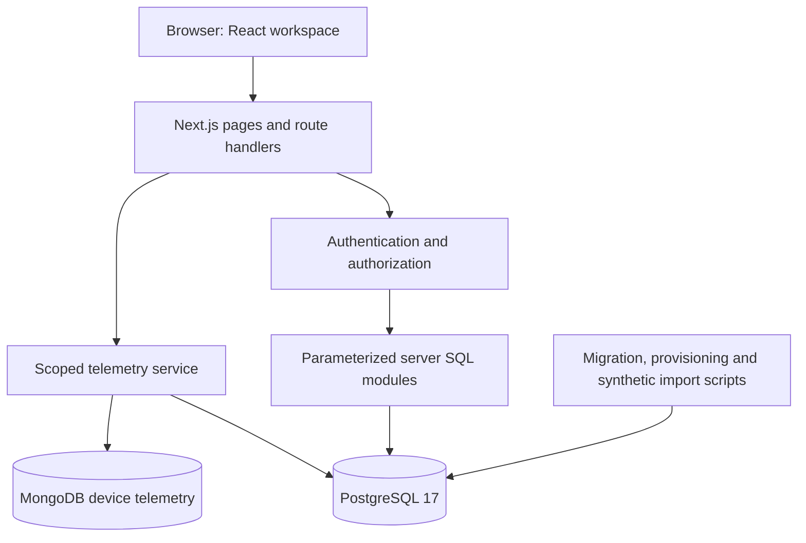
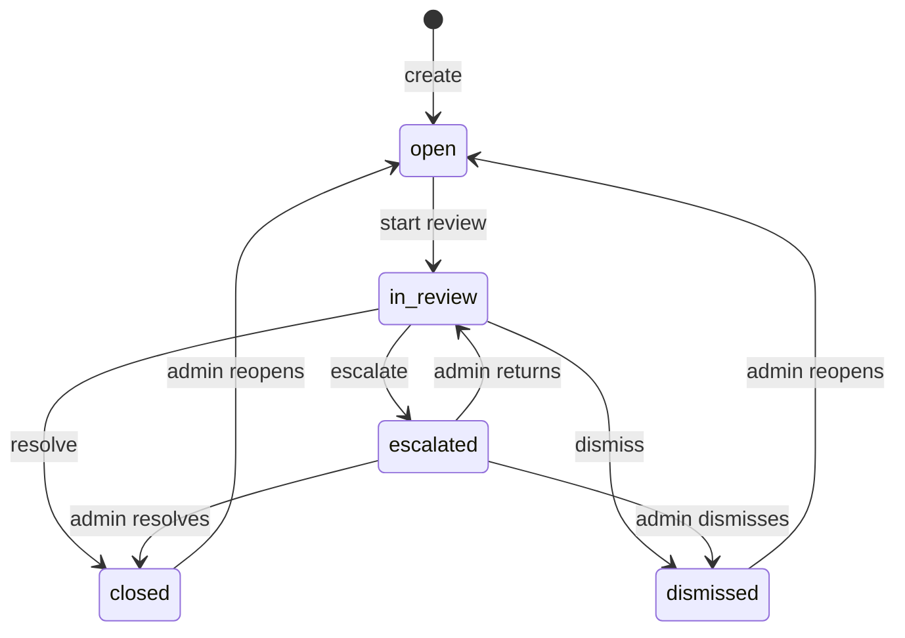

# Understanding FinSight

A learning guide to the implemented project, based on repository revision `93d833a`. Read sections 1–5 for the big picture, 6–11 for the technical design, and 12–16 to explore and explain it yourself. Local passwords and connection secrets deliberately belong only in ignored configuration.

## 1. What problem does this project solve?

FinSight helps an internal analyst review unusual financial transactions and record a traceable investigation. A transaction may deserve attention because its amount is large, its merchant has a high risk tier, or an investigator needs to inspect its context. FinSight presents recorded signals and lets an analyst open a case, investigate, escalate, and record an outcome.

The central question is: **Can we explain why a transaction was flagged and preserve who made each investigation decision?**

This is an academic application using synthetic data. It does not execute payments, transfer money, freeze accounts, recover funds, or establish that a person committed fraud. Its risk score is a deterministic review aid, not a machine-learning prediction or fraud probability.

An account balance in the seed is a fixture fact. Loading historical transactions does not simulate a banking ledger or recalculate that balance.

## 2. A complete example

Imagine a transaction for USD 125 at a merchant with a high risk tier.

1. The synthetic fixture stores an exchange rate of 80 INR per USD.
2. PostgreSQL derives the base amount: `125 × 80 = INR 10,000`.
3. The amount rule matches because the base amount is at least INR 10,000. It contributes 40 points.
4. The merchant rule matches because the merchant tier is high. It contributes 25 points.
5. The recorded total is 65, placing the transaction in the high band.
6. An analyst opens the transaction detail and sees the amount, merchant context, and both signal contributions.
7. The analyst creates a case, starts review, and either records a resolution, dismisses the concern, or escalates it.
8. PostgreSQL retains the case events so the decision can be explained later.

This is canonical transaction `30000000-0000-0000-0000-000000000106`. The rate of 80 belongs to the fixed regression fixture; it is not a current market rate. The larger optional demo generator uses separately saved historical FX observations.

## 3. Who uses it?

| Identity | Purpose | Important boundary |
|---|---|---|
| Analyst | Browse transactions, inspect evidence, create and work owned cases | Cannot inspect another analyst's private case details or perform admin-only transitions |
| Admin | Oversee cases, handle escalations/reopening, perform session cleanup | Does not receive permission to rewrite retained financial facts |
| Customer | Person represented in financial records | Is not a customer-facing login role |
| System identity | Schema-supported service identity | Is not an interactive human sign-in role |

Application roles and PostgreSQL roles are different. An analyst is a business identity in `app_user`. The runtime database role is an infrastructure login used by the server. Many application users share the server's restricted connection pool; the server supplies their validated identity to guarded operations.

The current case command interface supports create, start review, escalate, return to review, resolve, dismiss, and reopen. Do not infer working account administration, rule editing, assignment controls, or note editing from an older design proposal.

## 4. Architecture



**Browser:** Displays lists, forms, dialogs, and evidence. It sends filters and requested commands. It cannot grant itself a role or directly connect to a database.

**Next.js:** Hosts both the interface and backend in one project. React builds the screens; TypeScript describes expected shapes. App Router pages live in `src/app`. Route handlers receive HTTP requests, while server modules perform database work. Some flows also use server actions.

**PostgreSQL:** Owns financial facts, users, persisted sessions, case state, and immutable investigation history. Constraints and functions enforce rules even when requests arrive concurrently.

**MongoDB:** Holds heterogeneous device observations used as extra investigation context. PostgreSQL remains authoritative for which transaction and device may be queried.

There is no ORM. The server uses the `pg` driver and hand-written SQL. This makes joins, constraints, transactions, functions, and query plans visible parts of the project.

## 5. How one browser request travels

Consider opening a transaction detail page:

1. The browser navigates to `/transactions/<uuid>`.
2. The protected workspace checks the session. The transaction API also independently authenticates requests.
3. The server checks the current user's role and validates the transaction identifier.
4. `transactionRiskDetail` reads the transaction and its recorded risk evidence using parameterized SQL.
5. The telemetry service resolves the SQL transaction/device before attempting MongoDB reads.
6. The response contains permitted, masked fields. Raw password hashes and payment tokens do not belong in it.
7. The UI renders the facts, signals, related case visibility, and telemetry availability.

The versioned detail endpoint is `GET /api/v1/transactions/<uuid>`. Authentication, data access, and rendering are separate responsibilities, even though they share one Next.js application.

See [transaction API implementation](../src/server/transaction-api.ts) and [financial queries](../src/server/financial-queries.ts).

## 6. Understanding the relational data model

The schema has 17 application tables, plus migration metadata. Learn the tables in groups rather than memorizing every column.

| Group | Tables | What they represent |
|---|---|---|
| Customer and banking context | `customer`, `address`, `account`, `payment_method` | Who owns an account, where they are based, and which instrument belongs to it |
| Transaction context | `merchant`, `device_fingerprint`, `transaction` | Where activity happened and its financial facts |
| Explainable risk | `risk_rule`, `risk_signal` | Conditions and the stored evidence/contribution when they match |
| Evaluation fixtures | `fraud_scenario`, `transaction_label` | Synthetic expected scenarios used for verification |
| Operator identity | `app_user`, `app_session` | Human/service identities and persisted session state |
| Investigations | `investigation_case`, `case_event`, `case_command_receipt` | Current case state, history, and safe retry receipts |
| Administrative audit | `app_session_cleanup` | Preview/confirmation evidence for bounded session deletion |

Important relationships:

- A customer can have multiple accounts and addresses.
- An account can have multiple payment methods and transactions.
- A transaction references its account and can carry merchant, instrument, and device context according to schema constraints.
- A risk signal links a transaction to a rule. Unique transaction/rule pairs prevent duplicate recordings.
- A case refers to a transaction and can be assigned to an operator.
- Case events refer to the case and record its history.
- Sessions refer to operator identities, not financial customers.

`v_transaction_risk` is a view, not a separate table of copied totals. It derives totals and bands from transactions and recorded signals. `schema_migrations` tracks applied migration files and checksums.

UUIDs are stable identifiers used by storage and APIs. Shortened identifiers in the UI are display conveniences; use full UUIDs for exact lookups.

See the [schema catalog](printable/schema-catalog.json) and [printable ER and relational diagrams](printable/README.md).

## 7. Why the database constraints matter

A primary key uniquely identifies a row. A foreign key prevents a child from pointing to a nonexistent parent. A check constraint restricts valid values, such as supported statuses or nonnegative finite amounts. A unique constraint prevents duplicates that ordinary input validation could miss under concurrency.

FinSight adds project-specific protections:

- Composite relationships prevent a payment method from being attached to the wrong account.
- Exact numeric types preserve monetary values and conversion rules.
- Financial guards protect retained facts and risk evidence from mutation.
- A partial unique index allows historical terminal cases while preventing two active cases for one transaction.
- Case event guards reject history mutation.
- Restricted runtime grants expose approved reads and functions instead of broad table-write privileges.

Why not validate only in React? Two browsers can both pass a client-side check before either writes. Database constraints arbitrate the final result atomically. They also protect against mistakes in future scripts or backend code.

## 8. Risk scoring, step by step

| Rule code | Matching condition | Contribution |
|---|---|---|
| `AMOUNT_BASE_GTE` | Stored INR base amount is at least 10,000 | 40 |
| `MERCHANT_TIER_GTE` | Ordinal merchant tier is at least 2, meaning high | 25 |

The merchant mapping is low = 0, medium = 1, high = 2. These are ordinal codes, not probabilities. The SQL scoring function validates the approved rule configuration, locks the subject transaction, and records applicable signals once.

Each signal preserves an observed value, contribution, evidence, and recording time. The view aggregates stored contributions:

```text
risk_score = sum(recorded signal contributions)
```

| Score | Derived band |
|---|---|
| Below 35 | low |
| At least 35 and below 60 | medium |
| At least 60 and below 80 | high |
| At least 80 | critical |

The two seeded rules can produce only 0, 25, 40, or 65. The critical band exists in the general banding logic, but these two rules alone cannot reach it. Raw sums are not capped at 100, so a score must not be described as a percentage.

A transaction with zero recorded signals is displayed as having no recorded signals. This does not prove safety or even prove a complete evaluation: the schema has no separate scoring-run completeness record.

The evaluation labels in `transaction_label` are excluded from scoring predicates. Feeding an expected answer into a rule would make the demonstration circular.

Amounts, exchange rates, and scores travel through query/API boundaries as decimal strings to avoid JavaScript floating-point precision loss. Counts remain integers. PostgreSQL performs exact decimal conversion and rounding.

See [migration 040](../migrations/040_deterministic_risk.sql) and [canonical seed](../scripts/financial-seed.mjs).

## 9. Authentication and sessions

The working sign-in form posts JSON to `/api/auth/login`. This route checks request origin and content type, verifies credentials, creates a persisted session, encodes its token, and sets a protected cookie. The project also contains NextAuth Credentials configuration; the visible form uses the dedicated login route.

Passwords are stored as Argon2id hashes. Verification compares a supplied password with a hash; the database does not need to retain a recoverable plaintext password.

The cookie contains an encrypted token linked to a database session. Keeping a session row allows the server to recognize revocation and expiry rather than trusting possession of a token alone. Validation also checks the user's current active status and role.

Session limits are 30 minutes idle and 8 hours absolute. Idle expiry limits inactivity; absolute expiry limits the total lifetime even when the user remains active. Sign-out revokes the persisted session and clears the cookie.

There is no public registration or implemented password-recovery journey. Demo identities are explicitly provisioned by a setup script.

For local setup, `AUTH_SECRET` protects token handling, `NEXTAUTH_URL` identifies the browser origin, `DATABASE_URL` is the restricted runtime connection, and `MIGRATOR_DATABASE_URL` is the setup connection. Neither connection string belongs in committed documentation.

An invalid credential normally produces HTTP 401. A missing secret, unreachable database, or other authentication dependency failure can produce HTTP 503 and the message “Sign-in is temporarily unavailable.” Generating passwords alone does not create users: provisioning must run successfully against the migrated database.

See [login handler](../src/app/api/auth/login/route.ts), [authentication service](../src/server/authentication.ts), and [session service](../src/server/session.ts).

## 10. Case lifecycle and safe writes



An analyst creates a case assigned to themselves and works their own cases. Admins can oversee cases, return escalations, and reopen terminal cases. The database function checks additional requirements such as valid state, assignee, reasons, and resolution fields. The UI's visible button is not the final authority.

Three mechanisms protect a case command:

**Atomicity:** State changes, associated events, and the successful command receipt commit together. A failure must not leave changed state without its history.

**Optimistic concurrency:** The caller sends `expected_version`. Suppose two tabs both read version 3. The first command succeeds and changes the version to 4. The second command still expects 3, so it conflicts instead of silently overwriting newer work. The operator must refresh and review the new state.

**Idempotency:** A command has an idempotency key and a canonical payload hash. If a response is lost, retrying the same operation can return its receipt without applying the command again. Reusing a key for a different payload is not an acceptable retry.

Concurrency control and idempotency solve different problems: the first detects stale decisions; the second handles duplicate delivery.

The implemented command type list is in [case commands](../src/server/case-commands.ts). [Migration 050](../migrations/050_case_guards.sql) implements `execute_case_command` and related guards. Read [authorization](../src/server/authorization.ts) to understand the application-level checks.

## 11. Why MongoDB is present

Financial facts are highly relational and need strict consistency. Device observations can have different shapes, such as network connection properties or client environment properties. MongoDB provides a document model for those heterogeneous observations while PostgreSQL retains the core relational authority.

The `device_telemetry` collection uses a strict validator, not unrestricted arbitrary JSON. Two shapes are supported: `connection_telemetry` and `client_environment`. Common fields include device UUID, optional transaction UUID, capture time, and schema version.

The telemetry service resolves the transaction/device in SQL, excludes observations after the transaction time, and validates optional transaction references against SQL authority. Candidate observations are bounded to the most recent 100, with five recent samples and a two-second query time limit. Aggregation summarizes the bounded observations.

These cross-store UUID references are not native PostgreSQL foreign keys into MongoDB. Application checks enforce their scope. MongoDB failure produces unavailable telemetry while relational transaction and case workflows continue.

The current local setup described in our session has PostgreSQL and seeded financial data. MongoDB telemetry requires its own service, setup, and seed; signing in successfully does not imply telemetry is configured.

See [telemetry service](../src/server/telemetry.ts) and [MongoDB design](mongo-telemetry.md).

## 12. Audited deletion and retention

FinSight demonstrates meaningful SQL DELETE through old unusable sessions, while retaining financial and investigation evidence.

An active administrator previews at most 100 sessions whose earliest qualifying expiry/revocation is more than seven days old. The preview expires after ten minutes. Confirmation rechecks eligibility, deletes eligible captured sessions, and records the exact deleted count in the cleanup audit. Replaying the completed operation does not repeat deletion.

The runtime role does not receive general direct session DELETE authority. A guarded function implements the approved operation. Financial transactions, risk signals, users, cases, events, command receipts, and cleanup audit records remain retained.

This illustrates a practical distinction: some operational data can be removed under a narrow audited policy, while records needed to explain a financial investigation must survive.

See [session cleanup implementation](../src/server/session-cleanup.ts) and [migration 060](../migrations/060_session_cleanup.sql).

## 13. A map of the repository

| Location | Read it to understand |
|---|---|
| `src/app/(workspace)` | Protected overview, transactions, cases, settings and admin pages |
| `src/components/workspace` | Forms, tables, evidence panels and lifecycle dialogs |
| `src/app/api` | HTTP entry points, including login and versioned APIs |
| `src/server/auth*`, `session.ts` | Credential checks, origin/cookie security and persisted sessions |
| `src/server/financial-queries.ts` | Parameterized transaction queries and risk detail |
| `src/server/transaction-parameters.ts` | Filter validation and signed paging cursors |
| `src/server/case-*` | Case query, validation, HTTP and command responsibilities |
| `src/server/telemetry.ts` | SQL-authorized MongoDB reads |
| `src/lib` | Shared types, display utilities and database helpers |
| `migrations` | Ordered schema changes and database behavior |
| `scripts` | Migrations, provisioning, synthetic data and verification tooling |
| `tests` | Unit, API, database, browser and SQL verification |
| `docs/api` | OpenAPI contracts for transaction and case APIs |

The migration sequence explains how the project grew:

| Migration | Responsibility |
|---|---|
| 010 | Financial entities and relationships |
| 020 | Operators, sessions, cases, events and receipts |
| 030 | Financial integrity and retention guards |
| 040 | Deterministic scoring and risk view |
| 050 | Guarded investigation commands and runtime grants |
| 055 | Protected session validation |
| 060 | Audited session cleanup |

## 14. Running and exploring the project

The supported baseline is Node.js 24 and PostgreSQL 17. The local session was started with Node 22, which is outside the declared Node engine range even though the server started. Use Node 24 for reproducible development and checks.

For a clean machine, follow [development setup](development-setup.md): install dependencies, create separate owner/runtime roles, configure ignored `.env.local`, migrate, seed, provision users, and start the application. Optional MongoDB initialization is a separate step.

```powershell
npm ci
npm run db:migrate
npm run db:seed
npm run auth:provision -- --demo
npm run dev -- --port 3014
```

These commands assume prerequisites and configuration already exist. Do not copy migration-owner authority into the runtime connection just to make permissions errors disappear.

Suggested learning exercise:

1. Sign in as the analyst and open Transactions.
2. Compare a zero-signal transaction with transaction ending `106`.
3. Explain each contribution to the score of 65 using the stored evidence.
4. Create a case, start review, and inspect its history.
5. Escalate it with a reason, then sign in as admin to inspect allowed actions.
6. Compare the screen with the stored-function guards in migration 050.
7. Inspect the network request and response in browser developer tools. Never copy session cookies into shared reports.

The canonical seed contains eight deliberately small regression scenarios. For a larger explorer dataset, the optional `demo:fx` and `demo:import` scripts fetch/save historical rates and import linked synthetic activity. They are not required to understand the basic workflow.

## 15. How verification supports the design

| Check | What it helps establish |
|---|---|
| `npm run lint` | Static style and correctness rules |
| `npm run typecheck` | Type consistency and generated route types |
| `npm run test:unit` | Isolated parsing, security and utility behavior |
| `npm run test:db` | Real database constraints and guarded behavior |
| `npm run test:api` | HTTP behavior, authorization and integration |
| `npm run test:e2e` | Browser-visible workflows |
| `npm run test:acceptance` | The VS01–VS16 acceptance matrix |
| `npm run test:academic` | Broader SQL/Mongo/acceptance and provenance evidence |

Database and acceptance suites have additional environment requirements. Broad verification can reset a designated fresh `_test` database; it must never target a useful demo database. Read the setup and safety instructions before running those suites.

The repository retains a [historical verification record](academic/2026-10-30-verification.md). It is evidence for its pinned revision and environment, not proof that every future checkout or local setup passes. This guide is explanatory documentation and does not claim a new execution of those suites.

## 16. Explaining it in a presentation or viva

**A one-minute introduction:**

> FinSight is a synthetic financial transaction investigation application. Analysts inspect transactions and recorded rule-based risk evidence, then manage cases with traceable outcomes. Next.js provides the interface and backend. PostgreSQL preserves relational facts and enforces case commands, concurrency, and immutable history. MongoDB supplies bounded device telemetry. The emphasis is explainability and integrity rather than claiming predictive fraud accuracy.

| Likely question | Answer to understand |
|---|---|
| Why is this beyond CRUD? | Commands enforce state transitions, authority, version checks, idempotency, atomic history and retention rules. |
| Why two databases? | SQL fits relational financial integrity; document storage fits heterogeneous device observations. |
| Is the risk engine AI? | No. Two explicit deterministic rules produce explainable stored contributions. |
| Does high risk mean confirmed fraud? | No. A human investigation records an outcome; the score is a review aid. |
| Why store signals instead of calculating everything in the UI? | Stored evidence preserves the recorded contribution and observation; the UI displays the result. |
| What prevents duplicate active investigations? | A database partial unique index, alongside guarded command handling. |
| What if two tabs update one case? | Expected-version checks reject a stale decision. |
| What if a request is retried? | Idempotency receipts avoid applying the same successful command again. |
| Can admins delete history? | Admin application status does not bypass database retention guards. |
| What if MongoDB is offline? | Telemetry is unavailable; SQL-backed investigation remains usable. |
| What does a zero score prove? | Only that the aggregate contains no positive recorded contributions; it does not certify safety or evaluation completeness. |
| Which advanced database concepts are visible? | Transactions, joins/aggregates, views, stored functions, triggers, indexes, full-text search and MongoDB aggregation. |

For deeper reading, continue with [authentication](authentication.md), [transaction API](transaction-api.md), [case API](case-api.md), [case UI](case-ui.md), and the [academic submission report](academic/submission-report.md). Older design documents sometimes retain proposed or historical language; consult executable source, migrations, and pinned verification evidence before treating a proposal as a working feature.
